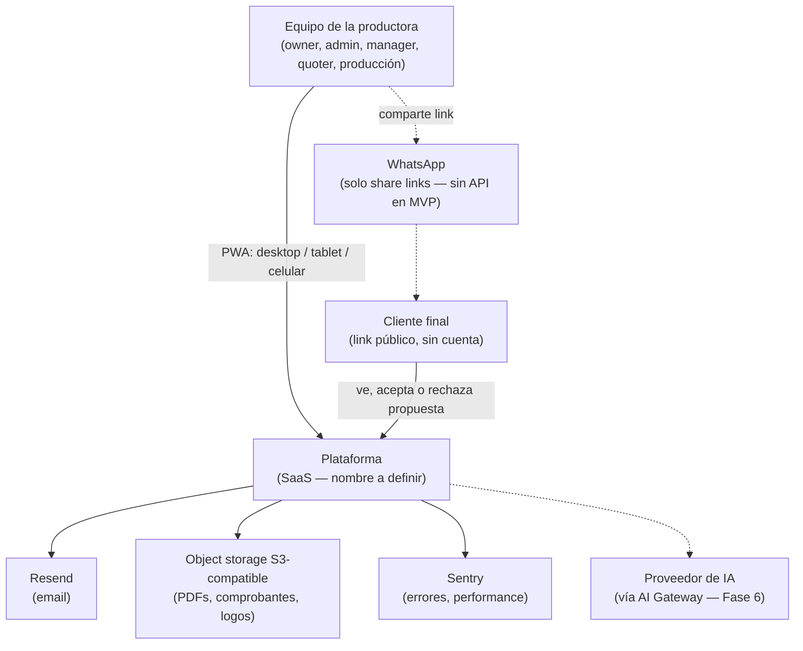
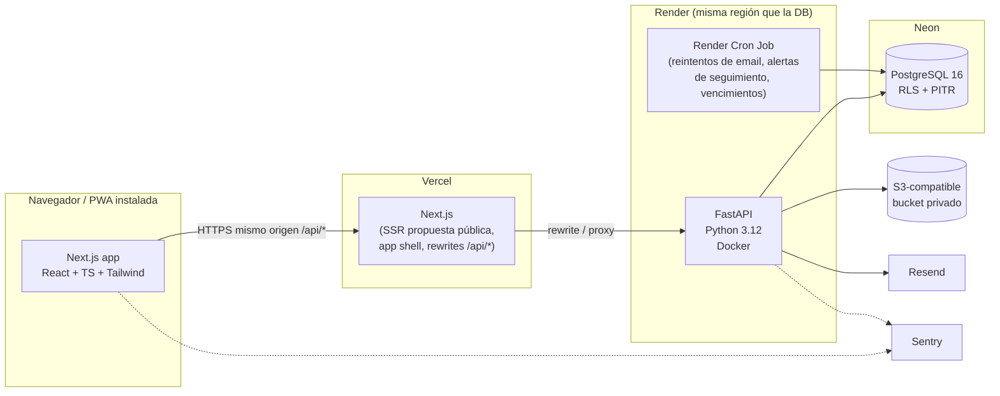
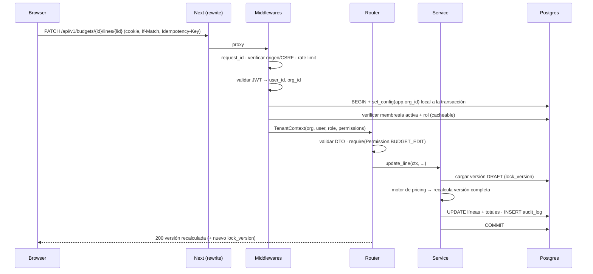

# ARCHITECTURE — Arquitectura técnica

> Estado: **borrador para aprobación** · Fecha: 2026-10-05
> Relacionados: [PRODUCT_SPEC](../product/PRODUCT_SPEC.md) · [DOMAIN_MODEL](../product/DOMAIN_MODEL.md) · [MVP](../product/MVP.md) · [DECISIONS](../product/DECISIONS.md)
> Las decisiones marcadas **D-xx** están justificadas (con alternativas) en DECISIONS.md.

---

## 1. Principios de arquitectura

1. **Monolito modular, no microservicios** (D-04). Un backend y una base de datos, con módulos de dominio y límites explícitos. La complejidad de este producto está en el dominio, no en la escala.
2. **El servidor es la única fuente de verdad del dinero** (D-05). El motor de pricing es **una sola implementación** (Python puro). El frontend nunca calcula importes: los muestra y los formatea.
3. **Inmutabilidad por construcción.** El historial de costos, las versiones congeladas, las propuestas y el audit log no se pueden modificar, y eso lo garantizan la aplicación **y** la base de datos (triggers y permisos).
4. **Aislamiento multi-tenant por construcción** (D-12). `organization_id` en todo, FKs compuestas, filtrado obligatorio en repositorios y **Row-Level Security** en Postgres como defensa en profundidad.
5. **Tecnología aburrida y poca infraestructura** (D-15). Sin Redis, sin colas y sin workers en el MVP mientras no hagan falta. Cada pieza nueva tiene que justificarse.
6. **Mobile-first real**, en UI y en red: payloads chicos, una sola ida y vuelta por edición e idempotencia para redes inestables en campo.
7. **Todo es verificable.** Lint, typecheck, tests, build y migraciones en CI. Nada se declara "funcionando" sin evidencia.

---

## 2. Contexto (C4 — nivel 1)



---

## 3. Contenedores y despliegue (C4 — nivel 2)



### 3.1 Decisiones de despliegue

| Tema | Decisión | Por qué |
|---|---|---|
| **Mismo origen** (D-13) | El browser habla con `app.dominio.com/api/*` y Next.js **reescribe** hacia Render. | Las cookies quedan como first-party, no hace falta CORS y los preview deployments de Vercel funcionan sin trucos de dominio. |
| **Región** (D-18) | Render **Virginia** + Neon **AWS us-east-1** (co-ubicados). | Un ORM hace varias queries por request; API y DB **tienen que** estar juntas. Desde Argentina hay ~130–170 ms de RTT a us-east. Medimos en la Fase 1 y, si molesta, se evalúa São Paulo. |
| **Tiers** (D-18) | **Todo en planes gratuitos**, también producción. Render free duerme a los 15 min sin tráfico (despierta en ~1 min); opcionalmente se mantiene despierta en horario de trabajo con un ping gratuito (DEPLOY §2b). Neon suspende el cómputo sin uso (~0,5 s al volver). | Decisión de costos de la dueña. Lo que se acepta: la primera visita fuera de horario tarda ~1 min. |
| **API como contenedor Docker** | Imagen con las libs de sistema de WeasyPrint (Pango). | El PDF se genera server-side (D-16). |
| **Migraciones** | `alembic upgrade head` al arrancar el contenedor (`RUN_MIGRATIONS=true`: el plan free no tiene pre-deploy command). | Si falla, el contenedor no arranca y Render mantiene la versión anterior. Exige migraciones *expand/contract* (compatibles hacia atrás). |
| **Storage** (D-17) | Cloudflare R2 (o AWS S3) con bucket privado. Los archivos entran y salen **por la API** (ver §8.6). | Compatible con S3 y sin costo de egreso. |

---

## 4. Backend

### 4.1 Stack

| Pieza | Elección | Nota |
|---|---|---|
| Lenguaje | Python 3.12 | |
| Framework HTTP | FastAPI | OpenAPI automático (es el contrato con el frontend) |
| Validación | Pydantic v2, modo estricto | Los importes viajan como **strings decimales** en JSON, nunca como floats |
| ORM | SQLAlchemy 2.0 (tipado `Mapped[]`) | **Sincrónico + psycopg 3** en el threadpool de FastAPI (D-19). Evita los problemas del async ORM (lazy loads, `MissingGreenlet`) y el throughput sobra para B2B. |
| Migraciones | Alembic | Con convenciones de nombres para constraints |
| Dinero | `decimal.Decimal` + tipos propios (`Money`, `Rate`) | Ver DOMAIN_MODEL §5 |
| Auth | Implementación propia (argon2id + JWT corto + refresh rotativo) | D-13 |
| PDF | WeasyPrint (HTML/CSS → PDF) | D-16 |
| Logs | structlog (JSON) | Con `request_id`, `org_id`, `user_id` |
| Tooling | uv, ruff (lint + format), mypy `--strict`, pytest, hypothesis, import-linter | |

### 4.2 Monolito modular: módulos

```
core/            config, db, seguridad, tenancy, errores, logging, ids, money, audit
domain/pricing/  MOTOR DE PRICING PURO (sin FastAPI, sin SQLAlchemy, sin I/O)
modules/
  auth            login, refresh, logout, reset de contraseña, invitaciones
  organizations   organización, datos fiscales, marca, configuración
  users           usuarios, membresías, roles
  clients         clientes, contactos, historial comercial (lectura)
  suppliers       proveedores, contactos, rubros, evaluación
  catalog         categorías, unidades, productos, ofertas, historial de costos,
                  paquetes, importación, aumento masivo
  pricing_rules   reglas de markup, cargos sobre la venta, tipos de cambio
  events          eventos, máquina de estados
  budgets         presupuestos, versiones, secciones, líneas, comparar, exportar
  proposals       propuestas, endpoints públicos, PDF, aprobación
  production      lista de contratación por proveedor, tareas
  finance         gastos reales, presupuestado vs real, rentabilidad
  documents       adjuntos (S3)
  notifications   emails (outbox)
  dashboard       métricas (solo lectura, queries agregadas)
  ai              Fase 6
```

### 4.3 Estructura interna de un módulo

```
modules/budgets/
├── __init__.py      # interfaz pública del módulo (lo único que otros módulos importan)
├── router.py        # HTTP: parseo, permisos, serialización. Sin lógica de negocio.
├── schemas.py       # DTOs Pydantic de entrada/salida
├── models.py        # modelos SQLAlchemy
├── service.py       # casos de uso: transacción, orquesta repos + dominio + audit
├── repository.py    # queries; SIEMPRE con alcance de tenant
└── policies.py      # reglas de autorización específicas del módulo
```

**Reglas de dependencia** (verificadas con `import-linter` en CI):

- `domain/*` no importa nada de `modules/*`, ni FastAPI, ni SQLAlchemy.
- `router → service → (repository, domain)`. El router nunca toca el repositorio.
- Un módulo usa a otro **solo** a través de su `__init__` (interfaz pública), nunca a través de sus `models` o `repository`.
- Los DTOs públicos (lo que ve el cliente final) viven en `proposals/public_schemas.py` y se construyen con **lista blanca** (§8.4).

> Respecto de la estructura propuesta en el brief original (`api/ models/ schemas/ services/ repositories/` por capa técnica): proponemos **organizar por dominio y no por capa**. Con 15 módulos, la organización por capa termina en carpetas de 40 archivos sin relación entre sí, y los límites entre módulos se diluyen. La separación en capas se mantiene, pero *dentro* de cada módulo.

### 4.4 Ciclo de vida de un request autenticado



### 4.5 Convenciones de API

- REST bajo `/api/v1`, orientado a recursos. El OpenAPI generado es **el contrato**.
- **Errores:** `application/problem+json` (RFC 9457) con un `code` estable (`budget.version_frozen`, `pricing.margin_out_of_range`, `tenant.not_found`). La UI traduce por `code`, no por mensaje.
- **Dinero:** strings decimales (`"270000.00"`). **Porcentajes:** fracciones como strings (`"0.350000"` = 35%).
- **Concurrencia optimista:** `If-Match: <lock_version>` en mutaciones de borradores. Un conflicto devuelve `409`.
- **Idempotencia:** `Idempotency-Key` obligatorio en POSTs sensibles (enviar propuesta, aceptar propuesta, crear gasto, importar). En campo la señal es mala y los reintentos no pueden duplicar.
- **Paginación:** por cursor.
- **Los IDs de otros tenants devuelven `404`, no `403`**, para no revelar que existen.
- **Campos computados:** el cliente **solo envía inputs** (cantidad, días, markup manual, modo). Los campos calculados que llegan en un request se ignoran o se rechazan.

---

## 5. Frontend

### 5.1 Stack

| Pieza | Elección | Nota |
|---|---|---|
| Framework | Next.js 16 (App Router) + React 19 + TypeScript `strict` | En Next 16, Middleware se llama Proxy |
| Estilos | Tailwind CSS + design tokens | |
| Componentes | **shadcn/ui** (Radix + Tailwind, código copiado al repo = "componentes propios") | Accesibilidad de Radix sin depender de una librería cerrada |
| Datos | **TanStack Query** + cliente tipado generado desde OpenAPI (`openapi-typescript` + `openapi-fetch`) | Los tipos del backend llegan al frontend sin duplicarse |
| Formularios | react-hook-form | Validación liviana en el cliente. La autoridad es el server. |
| PWA | Manifest nativo de Next + service worker mínimo (offline: página de aviso) | Serwist cuando haga falta offline real (V2) |
| Números | `Intl.NumberFormat('es-AR')` + parser propio es-AR con tests | Sin `<input type="number">` (bugs de locale en mobile): se usa `inputmode="decimal"` |
| Tests | Vitest (unit), Playwright (E2E, viewports mobile + desktop), axe (a11y) | |

### 5.2 Organización

```
frontend/src/
├── app/
│   ├── (auth)/login, (auth)/invite/[token], (auth)/reset
│   ├── (app)/                       # autenticado, layout con sidebar / tab bar
│   │   ├── page.tsx                 # dashboard
│   │   ├── events/…  budgets/…  catalog/…  clients/…  suppliers/…  reports/…  settings/…
│   └── (public)/p/[token]/page.tsx  # propuesta pública: SSR, sin cookies de sesión
├── components/ui/                   # shadcn (primitivas)
├── features/<módulo>/               # componentes + hooks por módulo (budget-editor, catalog, …)
├── lib/api/                         # cliente generado (schema.d.ts) + wrapper (auth, errores, idempotencia)
├── lib/format/                      # money, percent, dates (es-AR, America/Argentina/Buenos_Aires)
└── lib/parse/                       # parse-number es-AR (con tests exhaustivos)
```

### 5.3 Estrategia de render

- **App autenticada:** shell renderizado en el server y datos en el cliente con TanStack Query. Es una aplicación, no un sitio de contenido: no necesita SEO y gana interactividad y cache.
- **Propuesta pública:** **SSR**, con JS mínimo, LCP rápido en 4G y metadatos Open Graph para la vista previa de WhatsApp (*título y productora, nunca montos*), `noindex` y `Referrer-Policy: no-referrer`.
- **Offline (MVP):** app instalable con shell cacheado y sin mutaciones offline. En V2: lectura offline de los eventos del día y cola de gastos. La idempotencia de la API ya lo deja preparado.

### 5.4 Reglas del frontend

1. **Prohibido calcular dinero en el frontend.** Los importes son `MoneyString` (tipo con marca) y solo las funciones de `lib/format` los consumen.
2. Las mutaciones del editor se **serializan por presupuesto** (cola) para no autogenerar conflictos `409` con el autoguardado.
3. Los campos que no se pueden ver por permiso **no llegan** del server. La UI no esconde nada que haya recibido.
4. Accesibilidad WCAG 2.2 AA: navegación completa por teclado, foco gestionado en sheets y diálogos, targets táctiles ≥ 44 px.

---

## 6. El motor de pricing (arquitectura)

La especificación matemática está en [DOMAIN_MODEL §5](../product/DOMAIN_MODEL.md#5-motor-de-pricing--especificación). Acá se describe dónde vive y cómo se usa.

### 6.1 Diseño

```
domain/pricing/
├── __init__.py          # API pública: price_version(), preview()
├── types.py             # Money, Rate, Quantity (Decimal con invariantes)
├── inputs.py            # LineInput, VersionInput, PricingContext (dataclasses inmutables)
├── outputs.py           # LinePriced, VersionPriced, Explanation
├── rules.py             # resolución de markup (cadena de precedencia) → valor + origen
├── line.py              # cálculo por línea
├── version.py           # agregación, descuento global, cargos, IVA, precio objetivo
├── rounding.py          # política de redondeo (único lugar donde se redondea)
├── allocation.py        # reparto por mayor resto (precio objetivo, descuento global)
└── VERSION              # versión semántica del motor (se guarda en cada snapshot)
```

- **Funciones puras y deterministas:** `price_version(VersionInput, PricingContext) -> VersionPriced`. No hay I/O, no hay reloj y no hay floats.
- El `PricingContext` (reglas de markup aplicables, cargos sobre la venta, IVA, redondeo y tipos de cambio) lo **arma el service** (con las queries a la DB) y se lo pasa al motor ya resuelto. Así el motor se testea sin base de datos.
- Cada resultado incluye una **explicación** ("markup 30% · origen: categoría Gráfica"), que la UI muestra tal cual.

### 6.2 Una sola implementación

- **Todas las mutaciones del borrador recalculan la versión completa en el server** y devuelven el resultado. Recalcular 300 líneas con Decimal tarda unos milisegundos.
- `POST /api/v1/pricing/preview` permite simular sin persistir (por ejemplo, "¿qué pasa si pongo precio objetivo $4,6M?") antes de aplicar.
- Los **vectores dorados** (`backend/tests/pricing/vectors/*.json`: inputs + outputs esperados) no dependen del lenguaje. Si algún día la latencia exige un cálculo optimista en el cliente, esa implementación TS tiene que pasar **los mismos vectores** en CI. Hasta entonces no existe (D-05).

### 6.3 Latencia percibida en el editor

- El input muestra el valor tipeado al instante. Los campos calculados de la línea y el pie de totales muestran un estado sutil de "recalculando" hasta la respuesta, con un debounce de ~250 ms mientras se tipea.
- Presupuesto: ≤ 400 ms entre el fin del tipeo y los totales actualizados, medido desde Argentina en 4G. Si en la Fase 2 no se cumple, se reabre D-05 o D-18.

### 6.4 Versionado del motor

Cada versión congelada guarda `pricing_engine_version` y **todos** los inputs y outputs. La regresión de CI verifica que recalcular con el mismo motor produce exactamente los mismos outputs, y nada recalcula versiones congeladas en runtime. Si el motor cambia (por ejemplo, la política de redondeo), las versiones viejas **no cambian**: se leen tal como se guardaron.

---

## 7. Persistencia

### 7.1 Convenciones

| Tema | Convención |
|---|---|
| PK | `id uuid` **UUIDv7** (ordenable en el tiempo, no enumerable) |
| Números humanos | `number` secuencial **por organización** (`#1048`), vía tabla `number_sequences` con lock de fila |
| Tenant | `organization_id uuid NOT NULL` en toda tabla de negocio; índices que **empiezan** por `organization_id` |
| FKs entre tablas tenant | **Compuestas** `(organization_id, x_id) → x(organization_id, id)`: la DB impide referencias cruzadas entre organizaciones |
| Dinero | `NUMERIC(18,2)` para importes en moneda · `NUMERIC(18,6)` para costos unitarios y tipos de cambio · `NUMERIC(9,6)` para tasas (fracciones) |
| Cantidades | `NUMERIC(14,4)` (permite 6,5 m²) |
| Tiempo | `timestamptz` (UTC) · fechas de evento como `date` · TZ de la org `America/Argentina/Buenos_Aires` |
| Auditoría de fila | `created_at`, `created_by`, `updated_at`, `updated_by` |
| Soft delete | `deleted_at` **solo en datos maestros** (clientes, proveedores, productos, paquetes). Los registros financieros y snapshots no se borran. Unicidad con índices parciales `WHERE deleted_at IS NULL`. |
| Enums | `text` + `CHECK` (más fácil de migrar que los enums nativos de Postgres) |
| JSONB | **Solo** para snapshots (propuesta pública, contexto de pricing congelado) y configuración. Nunca para datos que se consultan o se unen. |

### 7.2 Aislamiento de tenants — tres capas

1. **Aplicación:** el `TenantContext` es obligatorio en todo service y repository. El repositorio base filtra por `organization_id` y por `deleted_at` y no tiene métodos "sin tenant".
2. **Base de datos (FK compuestas):** es imposible persistir una línea que apunte a un producto de otra organización.
3. **Row-Level Security:**
   ```sql
   ALTER TABLE budgets ENABLE ROW LEVEL SECURITY;
   ALTER TABLE budgets FORCE ROW LEVEL SECURITY;
   CREATE POLICY tenant_isolation ON budgets
     USING (organization_id = current_setting('app.org_id', true)::uuid)
     WITH CHECK (organization_id = current_setting('app.org_id', true)::uuid);
   ```
   - La app se conecta con el rol `app_runtime` (no es dueño de las tablas). Las migraciones corren con `app_migrator`.
   - `set_config('app.org_id', …, true)` es **local a la transacción**, así que es compatible con el pooler de Neon (PgBouncer en modo transacción). Si no está seteado, no hay filas: **falla cerrado**.
   - Los endpoints públicos (propuesta por token) resuelven `token_hash → organization_id` con una función `SECURITY DEFINER` acotada y después setean el contexto.

### 7.3 Inmutabilidad en la base

| Tabla | Garantía |
|---|---|
| `price_history` | Trigger `BEFORE UPDATE OR DELETE` → excepción (append-only) |
| `budget_lines`, `budget_sections`, `budget_versions` | Trigger: si la versión está `FROZEN`, no se puede modificar ni borrar |
| `proposals` | Solo se pueden modificar las columnas de estado y tracking. El snapshot y el hash no. |
| `audit_logs` | `REVOKE UPDATE, DELETE` al rol `app_runtime` |

### 7.4 Migraciones

- Alembic con autogenerate **revisado a mano**. Cada migración tiene `downgrade` y se prueba en CI (`upgrade head → downgrade -1 → upgrade head`).
- `alembic check` en CI: falla si los modelos tienen cambios sin migración.
- **Expand/contract:** nunca se renombra ni se borra una columna en el mismo deploy en que el código deja de usarla.
- Las políticas RLS y los triggers se crean **en las migraciones** (no en código aparte), con un test que verifica que **toda** tabla con `organization_id` tiene RLS habilitada.

---

## 8. Seguridad

### 8.1 Autenticación (D-13)

- Contraseñas con **argon2id**. Política mínima de 10 caracteres y chequeo contra contraseñas filtradas (k-anonymity HIBP, opcional).
- **Access token** JWT de 15 min en cookie `httpOnly; Secure; SameSite=Lax`.
- **Refresh token** opaco (256 bits), guardado **hasheado**, con rotación en cada uso y **detección de reutilización** (si se reusa uno viejo, se revoca toda la familia). Duración de 30 días deslizantes, en cookie `httpOnly` con `Path=/api/v1/auth`.
- Logout revoca la familia. Cambiar la contraseña revoca todas las sesiones.
- Invitaciones y reset de contraseña con token de un solo uso, hasheado y con expiración (24 h / 1 h).
- MFA (TOTP) y Google login: V2.

### 8.2 Autorización

- Permisos granulares en código (`Permission.BUDGET_EDIT`, `Permission.COST_VIEW`, `Permission.MARGIN_VIEW`, …) mapeados desde los roles fijos (matriz en PRODUCT_SPEC §9).
- La dependencia `require(Permission.X)` va en cada endpoint. Un test **enumera todas las rutas** y falla si alguna no declara su permiso (o no está explícitamente marcada como pública).
- **Redacción a nivel de campo:** los serializers reciben el set de permisos. Sin `MARGIN_VIEW`, los campos `markup`, `margin` y `profit` **no se emiten**.
- La membresía y el rol se re-validan en cada request: revocar el acceso es inmediato aunque el JWT siga vigente.

### 8.3 CSRF, headers y transporte

- Cookies `SameSite=Lax` + mismo origen + **verificación de `Origin`** + header custom obligatorio en mutaciones (`X-Requested-With`).
- Headers: HSTS, CSP estricta (sin `unsafe-inline` en scripts), `X-Content-Type-Options`, `frame-ancestors 'none'` y `Referrer-Policy: strict-origin-when-cross-origin` (`no-referrer` en `/p/*`).
- **CSP con nonce por request** (`frontend/src/proxy.ts` y `src/lib/csp.ts`): `script-src 'self' 'nonce-…' 'strict-dynamic'`, estilos con el mismo nonce, `connect-src` solo al mismo origen (y al ingest de Sentry si hay DSN). Next le pone el nonce a sus scripts al renderizar, así que **todas las páginas se renderizan por request** (`connection()` en el layout raíz). Se descartó SRI (experimental): no cubre los scripts inline de Next y la app no carga. El e2e `csp.spec.ts` falla si alguna pantalla viola la política y verifica que un script inyectado no corre.

### 8.4 Propuestas públicas

- Token aleatorio de 256 bits (`secrets.token_urlsafe(32)`). En la DB se guarda **solo el hash SHA-256**, así que un dump no expone links válidos.
- El link vence cuando termina la vigencia más un margen de gracia configurable (solo lectura tras el vencimiento). Se puede revocar. Al enviar una versión nueva, la anterior queda reemplazada.
- **El snapshot público se construye por lista blanca** en un DTO separado (`PublicProposal`) en el momento de congelar. No es el modelo interno "con campos excluidos". Un test recorre recursivamente el JSON público y falla si aparece cualquier clave prohibida (`cost`, `markup`, `margin`, `profit`, `supplier`, `internal`, `notes`) o un valor igual a un costo interno.
- La aceptación registra nombre, email, comentario, IP, user-agent, timestamp y el **hash SHA-256 del JSON canónico del snapshot**. Es la evidencia de *qué* se aceptó.
- Hay rate limiting por token e IP en ver, aceptar y rechazar, y `Idempotency-Key` en aceptar y rechazar.

### 8.5 Rate limiting

En el MVP se usa `slowapi` en memoria (una sola instancia): login (por IP y por email), reset, invitaciones, endpoints públicos e import. **Al escalar a más de una instancia hace falta un store compartido** (Redis o Postgres). Está anotado como disparador para introducir Redis (D-15).

### 8.6 Archivos

Los comprobantes y las OC **pasan por la API** (`core/storage.py`, módulo `documents`):

- **Subida:** el navegador achica las fotos (2000 px, JPEG) y manda el archivo en base64. El server valida **antes de guardar**: ≤ 10 MB y tipo por los primeros bytes (JPG, PNG, WEBP, HEIC o PDF), nunca por la extensión ni por el content-type declarado. Rate limit por usuario.
- **Clave:** `{organization_id}/{tipo}/{document_id}`, sin nada que venga del usuario. La fila de `documents` es inmutable (el rol de runtime solo tiene `SELECT, INSERT`).
- **Descarga:** por la ruta de la entidad dueña (`GET /expenses/{id}/receipt`, `GET /proposals/{id}/purchase-order`), con su permiso y su aislamiento por organización. Se sirve con el tipo detectado y `X-Content-Type-Options: nosniff`.
- El bucket es privado y no se expone nunca: no hay URLs presignadas ni CORS que configurar.
- *Por qué no PUT presignado (el plan original):* el tamaño no se puede limitar de verdad con un PUT presignado (R2 no soporta POST con `content-length-range`), lo subido sin validar ya está en el bucket, y hay que configurar CORS en el bucket. Con fotos achicadas (~300 KB) pasar por la API no pesa. Si algún día se suben archivos grandes, se vuelve al presignado con verificación posterior.

### 8.7 Secretos, dependencias y datos

- Los secretos viven solo en las variables de entorno de Render y Vercel. Hay `gitleaks` en CI, Dependabot, `pip-audit` y `pnpm audit`.
- **Backups:** el restore de Neon (6 horas en el plan gratis) más un `pg_dump` **diario** cifrado al bucket desde GitHub Actions (`backup.yml`, 30 días). Cada corrida **restaura el dump en un Postgres vacío y compara las filas**: el simulacro de restore es automático y diario. Procedimiento de restore en DEPLOY §7.
- **Datos personales:** se aplica la Ley 25.326 (Argentina). Hay exportación completa de datos por organización y baja de organización con borrado diferido. Sentry tiene scrubbing de PII **y de importes** (son datos comerciales sensibles).

### 8.8 Audit log

Es append-only y se escribe **en la misma transacción** que el cambio. Registra: `organization_id`, actor (usuario, token público o sistema; en Fase 6, IA con usuario responsable), acción (`price.changed`, `budget.version_frozen`, `proposal.accepted`, `markup.overridden`, `event.status_changed`, `expense.created`, `membership.role_changed`, …), entidad, diff before/after, IP, user-agent, `request_id` y timestamp. El listado completo de acciones está en DOMAIN_MODEL §7.

---

## 9. Trabajo asíncrono, email y PDF

| Necesidad | MVP | Cuándo cambiar |
|---|---|---|
| Emails (propuesta enviada, vista, aceptada; invitaciones) | Tabla **outbox** (`outbound_messages`) escrita en la transacción. Se envía después del commit (BackgroundTask) y un **Render Cron** cada 5 min reintenta los pendientes o fallidos. | Si el volumen o la latencia lo piden: cola en Postgres (`procrastinate`) |
| PDF de propuesta | **Sincrónico** en la primera descarga (WeasyPrint, ~1 s), cacheado en S3 con clave `content_hash`. Como el snapshot es inmutable, el PDF también. | Si tarda > 3 s o consume mucha memoria: worker aparte |
| Alertas de seguimiento y vencimientos | Render Cron diario | — |
| Rate limiting compartido / cache | No hace falta (una instancia) | Más de una instancia de API → Redis |

**Email:** Resend, enviando desde `notificaciones@<dominio-producto>` con `Reply-To` del usuario que envía. SPF, DKIM y DMARC configurados. En V2, dominio propio por productora.

---

## 10. Observabilidad

- **Sentry** en frontend y backend, con *release tracking* (SHA del commit), entorno, `org_id` y `user_id` como tags (sin email), traces muestreados y scrubbing de PII e importes.
- **Logs estructurados** JSON con `request_id` propagado (header `X-Request-Id`) desde Next hasta la API.
- `/healthz` (proceso) y `/readyz` (DB). Hay un monitor externo de uptime sobre `/readyz` y sobre una propuesta pública de prueba.
- **Eventos de producto** mínimos (para las métricas de éxito de PRODUCT_SPEC §11) en una tabla propia, sin herramientas de terceros en el MVP.

---

## 11. Capa de IA (Fase 6 — se diseña ahora para no acoplar)

```
modules/ai/
├── gateway.py         # interfaz AIGateway: complete_structured(prompt, schema, tools) -> Model
├── providers/         # adaptadores (Anthropic por defecto; otros intercambiables)
├── prompts/           # plantillas versionadas en el repo
├── tools.py           # herramientas de SOLO LECTURA: search_catalog, list_packages, get_event_defaults
├── drafting.py        # texto libre → BudgetDraft
└── matching.py        # texto → productos del catálogo (pg_trgm + full-text; pgvector en V2+)
```

**Reglas:**

1. La IA devuelve un **`BudgetDraft` estructurado** (validado con Pydantic) con referencias a `product_id` **del catálogo de la organización**, cantidades, días y nivel de confianza. **Nunca devuelve precios.** Los precios los calcula el motor.
2. El server valida que cada ID exista y pertenezca a la organización. Lo que no se encontró queda como "línea libre sugerida" para que el humano la resuelva.
3. Nada se confirma automáticamente. El usuario revisa y acepta, línea por línea o todo junto.
4. Cada interacción queda en `ai_interactions` (modelo, tokens, costo, latencia, si se aceptó, usuario). Hay tope de costo y rate limit por organización.
5. Solo viajan al proveedor los datos mínimos (el texto del pedido y el subconjunto relevante del catálogo, sin costos). Nunca datos de otra organización.

---

## 12. Entornos y CI/CD

### 12.1 Entornos

| Entorno | Frontend | API | DB | Uso |
|---|---|---|---|---|
| Local | `next dev` | `uvicorn --reload` | Postgres 16 en Docker Compose (+ Mailpit para email; los archivos van a `backend/.storage/`) | Desarrollo |
| Preview (por PR) | Vercel Preview | API de staging | DB de staging | Revisar UI (solo PRs sin migraciones). V2: Neon branch + API efímera por PR. |
| Staging | Vercel (branch `main`) | Render (auto-deploy desde `main`) | Neon branch `staging` | QA, demo |
| Producción | Vercel (tag o promoción) | Render (deploy manual o por tag) | Neon `main` | Piloto |

### 12.2 Pipeline (GitHub Actions)

```
ci.yml (cada PR y push a main)
├── backend
│   ├── uv sync --frozen
│   ├── ruff check · ruff format --check
│   ├── mypy --strict
│   ├── import-linter (reglas de dependencia entre módulos)
│   ├── pytest (con service container Postgres 16, RLS real)
│   │     └── cobertura: domain/pricing 100% de branches; global ≥ 85%
│   ├── alembic upgrade head · alembic check · downgrade -1 · upgrade head
│   └── exportar openapi.json
├── contract
│   └── regenerar cliente TS desde openapi.json → git diff --exit-code
├── frontend
│   ├── pnpm install --frozen-lockfile
│   ├── eslint · tsc --noEmit
│   ├── vitest
│   └── next build
└── security
    ├── gitleaks
    └── pip-audit · pnpm audit (informativo al inicio)

e2e.yml (PRs con label `e2e`, main y nightly)
└── docker compose up → Playwright (viewport iPhone 14 + desktop 1440) + axe

backup.yml (nightly)  → pg_dump cifrado a S3
```

**Regla:** no se mergea con CI en rojo. Un test que falla nunca se saltea ni se pone en cuarentena para "pasar".

---

## 13. Estrategia de testing

### 13.1 Pirámide

| Nivel | Qué | Herramienta | Cuándo corre |
|---|---|---|---|
| **Unit — motor de pricing** | Cada fórmula, redondeo, reparto, cadena de markup y casos borde | pytest + **hypothesis** (propiedades) + **vectores dorados** | Cada PR |
| **Unit — dominio** | Máquinas de estado, diff de versiones, parser de importación | pytest | Cada PR |
| **Integración API + DB** | Endpoints contra un Postgres real (no SQLite: RLS y triggers solo existen en Postgres) | pytest + httpx + Postgres en CI | Cada PR |
| **Seguridad automatizada** | Aislamiento de tenants, permisos, visibilidad pública, inmutabilidad | pytest (suites parametrizadas sobre todas las rutas) | Cada PR |
| **Contrato** | OpenAPI ↔ cliente TS | diff en CI | Cada PR |
| **Frontend unit** | Parser numérico es-AR, formatters, componentes críticos | Vitest | Cada PR |
| **E2E** | Journeys J2, J3, J4, J6 en mobile y desktop | Playwright + axe | Label, main, nightly |
| **Aceptación con datos reales** | **3–5 presupuestos reales de la productora reproducidos al centavo** | Vectores dorados + E2E | Cierre de la Fase 2 |

### 13.2 Propiedades del motor (hypothesis)

- `margen == markup / (1 + markup)` para todo costo > 0 (dentro de la tolerancia del redondeo).
- `precio_desde_margen(costo, margen_de(precio)) ≈ precio` (ida y vuelta).
- **Σ importes de línea visibles == subtotal**, exacto, siempre.
- Con precio objetivo P (múltiplo del incremento de redondeo) y líneas no bloqueadas con costo > 0, el **total es exactamente P**.
- Monotonía: más cantidad nunca da menos costo. Más markup nunca da menos precio.
- El descuento global repartido por línea suma exactamente el descuento global.
- Margen objetivo `g` con cargos `c`: el margen resultante después de cargos es `g` (± redondeo). Si `g + c ≥ 1`, el motor rechaza.

### 13.3 Casos obligatorios del brief → tests concretos

| Caso del brief | Test |
|---|---|
| 1. El costo cambia después de crear el presupuesto | Crear un borrador con la lona a $100.000 → nuevo `price_history` a $150.000 → el borrador sigue a $100.000 y avisa de "costo más nuevo" → al aplicar la actualización pasa a $150.000. Una versión **congelada** sigue a $100.000 siempre (y el trigger rechaza el UPDATE directo). |
| 2. El proveedor cambia el precio | Aumento masivo +8% → crea N filas nuevas de historial, 0 UPDATEs. Los presupuestos enviados no cambian (comparación del hash). |
| 3. Cambia el markup | Cambiar el markup de una categoría → los borradores **existentes** no cambian salvo con "re-aplicar reglas". Las líneas nuevas toman el valor nuevo. Las versiones congeladas no cambian. El origen del markup se muestra correcto. |
| 4. Presupuesto con múltiples versiones | v1 congelada → v2 borrador clonado con los mismos `line_key` → modificar → congelar → `compare(v1, v2)` reporta exactamente las líneas agregadas, quitadas y modificadas → la propuesta de v1 queda `SUPERSEDED`. |
| 5. Organización A intenta acceder a B | Suite **parametrizada sobre todas las rutas**: con un usuario de A y cada ID de B, se espera `404` en GET, PATCH y DELETE. También se testea directo contra la DB que RLS devuelve 0 filas y que la FK compuesta rechaza referencias cruzadas. |
| 6. Cliente público intenta ver información interna | El JSON y el HTML de `/p/{token}` y el PDF no contienen claves ni valores prohibidos. Un token inválido, vencido o revocado devuelve 404/410. Con el token de la propuesta X no se puede leer la propuesta Y. No hay enumeración por timing. |

Además: test de **permisos** (rol × endpoint → esperado, generado desde la matriz), test de **redacción de campos** (PRODUCTION no recibe `margin`), test de que **toda tabla con `organization_id` tiene RLS** y test de **idempotencia** (aceptar dos veces da un solo registro).

---

## 14. Estructura del repositorio

> Se usa este repositorio (`turnos-whatsapp`, hoy vacío) como base del proyecto (D-01, decidido). El nombre del repo y el README se actualizan cuando se defina el nombre del producto.

```
/
├── backend/
│   ├── pyproject.toml · uv.lock · alembic.ini · Dockerfile
│   ├── migrations/                     # Alembic (incluye RLS, triggers, roles)
│   ├── src/app/
│   │   ├── main.py                     # app FastAPI, middlewares, routers
│   │   ├── core/                       # config · db · security · tenancy · errors · logging · audit · ids · money
│   │   ├── domain/pricing/             # motor puro (ver §6.1)
│   │   ├── modules/<módulo>/           # router · schemas · models · service · repository · policies
│   │   └── templates/                  # proposal.html (PDF) · emails
│   ├── scripts/                        # seed, crear organización, import de prueba
│   └── tests/
│       ├── pricing/  (unit + property + vectors/*.json)
│       ├── domain/
│       ├── api/      (integración por módulo)
│       ├── security/ (tenant isolation, permissions, public visibility, immutability)
│       └── conftest.py
├── frontend/
│   ├── package.json · pnpm-lock.yaml · next.config.ts · tailwind.config.ts
│   ├── src/ (ver §5.2)
│   └── tests/ (unit · e2e)
├── infra/
│   ├── docker-compose.yml              # postgres, minio, mailpit
│   └── render.yaml                     # blueprint: web service + cron
├── docs/
│   ├── product/  PRODUCT_SPEC · DOMAIN_MODEL · MVP · DECISIONS
│   └── architecture/ ARCHITECTURE
├── .github/workflows/  ci.yml · e2e.yml · backup.yml
├── CLAUDE.md                           # reglas de trabajo para agentes (§30 del brief)
├── Makefile                            # make dev · test · lint · typecheck · migrate · e2e
└── README.md
```

---

## 15. Objetivos de performance

| Métrica | Objetivo |
|---|---|
| Mutación del editor (server) | p95 < 120 ms en el server · < 400 ms end-to-end desde AR en 4G |
| Lecturas de listas y fichas | p95 < 300 ms |
| Dashboard | p95 < 800 ms (y si no se cumple, vistas materializadas) |
| Editor con 300 líneas | Sin jank (virtualización a partir de 100 líneas) |
| Propuesta pública | LCP < 2,5 s en 4G · JS < 150 KB |
| PDF | < 3 s la primera vez · instantáneo desde cache |

---

## 16. Riesgos técnicos

| # | Riesgo | Prob. | Impacto | Mitigación |
|---|---|:-:|:-:|---|
| RT1 | **Errores de cálculo financiero** (floats, redondeos, orden de operaciones) | Media | Crítico | `Decimal` en todos lados, redondeo en un único módulo, tests de propiedades, vectores dorados, presupuestos reales reproducidos al centavo y montos como strings en JSON |
| RT2 | **Fuga de datos entre organizaciones** | Baja | Crítico | Tres capas (app, FK compuestas, RLS), suite parametrizada sobre todas las rutas y test de que toda tabla tiene RLS |
| RT3 | **Fuga de costos o márgenes al cliente** | Baja | Crítico | DTO público por lista blanca congelado, test de claves y valores prohibidos sobre JSON, HTML y PDF |
| RT4 | **Latencia** Argentina ↔ us-east en el editor | Media | Alto | Una ida y vuelta por edición, payloads chicos, API y DB co-ubicadas, medición en la Fase 1 y plan B en D-05 / D-18 |
| RT5 | **Cold starts** (Render free, Neon scale-to-zero) | Alta si se usa free | Alto | Tiers pagos en producción (costo bajo y conocido) |
| RT6 | **Edición concurrente** del mismo borrador | Baja | Medio | Lock optimista por versión, cola de mutaciones en el cliente y mensaje claro |
| RT7 | **Evolución del esquema de snapshots** JSON | Media | Medio | `snapshot_schema_version` y lectores versionados. Nunca se migran snapshots in-place. |
| RT8 | **Auth propia mal hecha** | Media | Alto | Checklist OWASP ASVS L2, librerías probadas (argon2-cffi, PyJWT), tests de rotación y reutilización, revisión de seguridad antes de producción |
| RT9 | **Importación de Excel sucio** (formatos, comas, monedas) | Alta | Medio | Vista previa, simulación, reporte de errores por fila, parser es-AR compartido con la UI y fixtures con los Excel reales del piloto |
| RT10 | **Fidelidad y memoria del PDF** | Baja | Medio | WeasyPrint con plantilla simple, cache por hash y Playwright como plan B |
| RT11 | **Rate limiting en memoria** al escalar | Baja (MVP) | Medio | Disparador documentado: más de una instancia → Redis |
| RT12 | **La IA inventa productos o precios** | Media | Alto | La IA no produce precios, los IDs se validan contra el catálogo y nada se confirma sin un humano |
| RT13 | **Deploys con migraciones rompen la versión anterior** | Media | Alto | Expand/contract, pre-deploy de Render y prueba de downgrade en CI |
