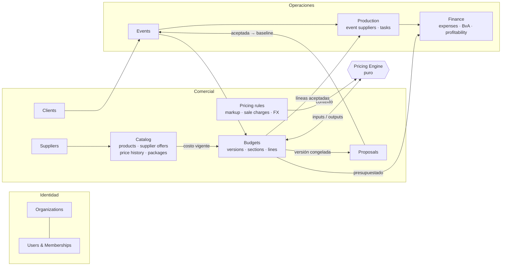
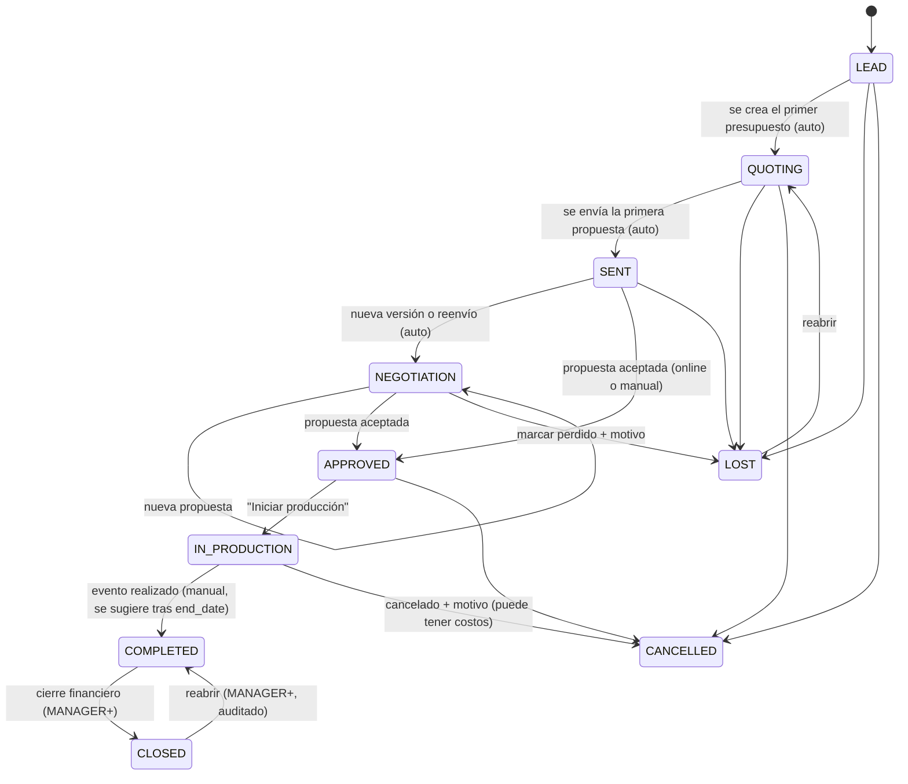
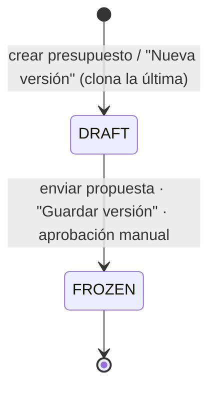
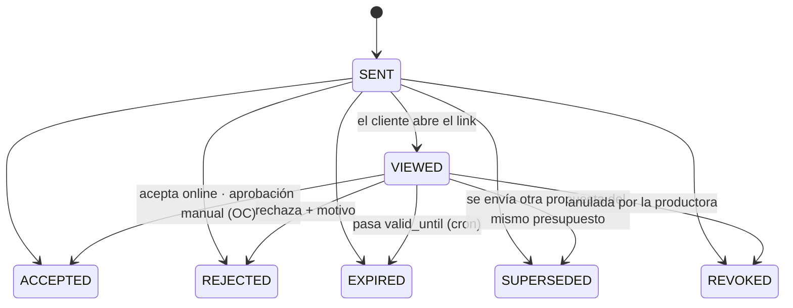
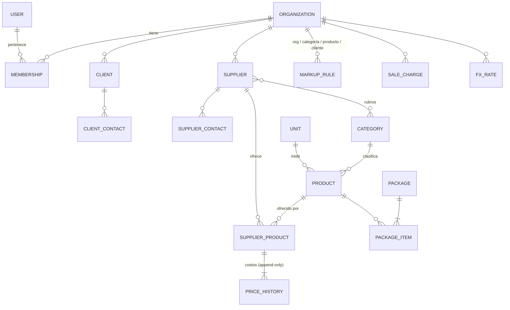
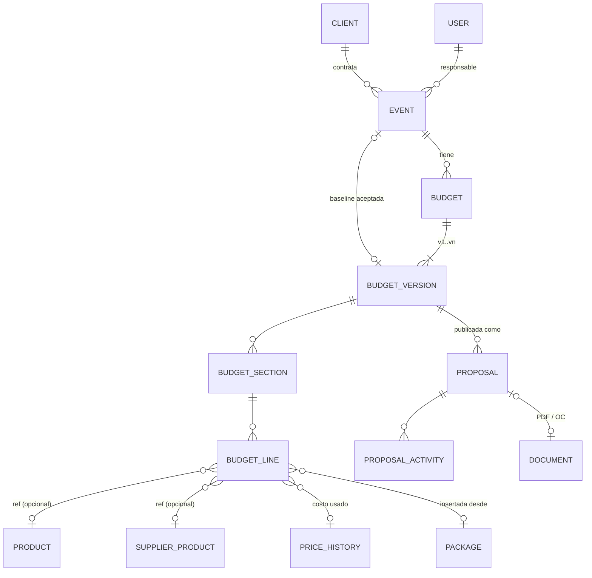
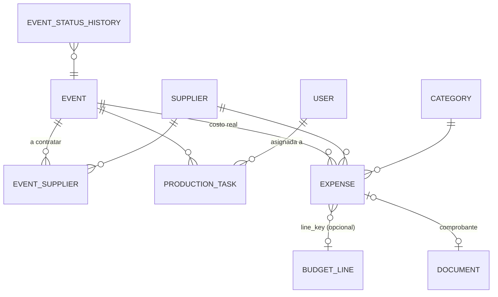

# DOMAIN MODEL — Modelo de dominio y de datos

> Estado: **borrador para aprobación** · Fecha: 2026-10-05
> Relacionados: [PRODUCT_SPEC](./PRODUCT_SPEC.md) · [ARCHITECTURE](../architecture/ARCHITECTURE.md) · [MVP](./MVP.md) · [DECISIONS](./DECISIONS.md)

Convenciones: los nombres de entidades y campos están en inglés (es el código). Las explicaciones están en español. Toda entidad marcada 🏢 lleva `organization_id`, RLS y FKs compuestas (ARCHITECTURE §7.2).

---

## 1. Mapa de contextos



**Flujo de datos sin re-carga (P1):** `price_history → budget_line (snapshot) → proposal (snapshot público) → accepted version (baseline) → event_suppliers / tasks → expenses (vinculados por line_key) → budget vs actual → profitability`.

---

## 2. Entidades

### 2.1 Identidad y tenancy

| Entidad | Campos clave | Notas |
|---|---|---|
| `organizations` | `name`, `legal_name`, `tax_id` (CUIT), `tax_condition` (`RI` / `MONOTRIBUTO` / `EXENTO`), `base_currency` (ARS), `timezone`, `logo_document_id`, `brand_color`, `settings` (JSONB tipado) | La raíz del tenant. `settings` incluye redondeo, vigencia por defecto, margen mínimo, días de antigüedad de costos, umbral de "para seguir", modo de propuesta por defecto y si VIEWER ve costos y márgenes. |
| `users` | `email` (único global), `name`, `password_hash`, `is_active`, `last_login_at` | **Global**: una persona puede estar en varias organizaciones |
| `memberships` 🏢 | `user_id`, `role` (`OWNER` / `ADMIN` / `MANAGER` / `QUOTER` / `PRODUCTION` / `VIEWER`), `status` (`INVITED` / `ACTIVE` / `DISABLED`) | Único por (`organization_id`, `user_id`). Al menos un OWNER activo por organización. |
| `invitations` 🏢 | `email`, `role`, `token_hash`, `expires_at`, `accepted_at` | |
| `auth_sessions` | `user_id`, `family_id`, `refresh_token_hash`, `active_organization_id`, `expires_at`, `revoked_at`, `ip`, `user_agent` | Rotación con detección de reutilización |
| `number_sequences` 🏢 | `kind` (`event`, `budget`, `proposal`), `next_value` | Numeración humana por organización |

### 2.2 CRM

| Entidad | Campos clave | Notas |
|---|---|---|
| `clients` 🏢 | `name`, `legal_name`, `tax_id`, `tax_condition`, `address`, `city`, `notes`, `deleted_at` | El historial comercial (conversión, facturado, margen) **se calcula**, no se guarda |
| `client_contacts` 🏢 | `client_id`, `name`, `position`, `email`, `phone`, `is_primary` | |

### 2.3 Proveedores y catálogo

| Entidad | Campos clave | Notas |
|---|---|---|
| `suppliers` 🏢 | `name`, `legal_name`, `tax_id`, `tax_condition`, `payment_terms`, `notes`, `rating` (1–5), `rating_notes`, `is_internal`, `deleted_at` | `is_internal = true` es "Equipo propio" (uno por organización, creado al inicio) |
| `supplier_contacts` 🏢 | `supplier_id`, `name`, `email`, `phone`, `is_primary` | |
| `supplier_categories` 🏢 | `supplier_id`, `category_id` | Rubros del proveedor |
| `categories` 🏢 | `name`, `parent_id` (opcional, un nivel), `default_iva_rate`, `sort` | Gráfica, Estructura, Personal, Transporte, Alquiler, Terceros… |
| `units` 🏢 | `code`, `name`, `allows_decimals` | unidad, m², m lineal, día, hora, persona, viaje, global |
| `products` 🏢 | `name`, `category_id`, `unit_id`, `charge_mode` (`FIXED` / `PER_DAY`), `description_internal`, `description_client`, `min_quantity`, `iva_rate` (nullable → categoría), `is_active`, `deleted_at` | Ítem **genérico** del catálogo. El markup propio vive en `markup_rules`. |
| `supplier_products` 🏢 | `product_id`, `supplier_id`, `supplier_sku`, `is_preferred`, `notes`, `is_active` | La "oferta": este proveedor ofrece este producto. Como máximo una preferida por producto. |
| `price_history` 🏢 | `supplier_product_id`, `amount`, `currency`, `amount_includes_iva`, `iva_rate`, `valid_from`, `source` (`MANUAL` / `IMPORT` / `BULK_UPDATE` / `SUPPLIER_QUOTE`), `source_ref`, `created_by`, `created_at` | **Append-only** (trigger). Costo vigente = el `valid_from` más reciente que sea ≤ hoy. `valid_to` se **deriva** del siguiente registro (no se guarda, así se evita tener que actualizar filas). Se permiten fechas futuras ("desde el 1/11"). |
| `packages` 🏢 | `name`, `description`, `is_active`, `deleted_at` | |
| `package_items` 🏢 | `package_id`, `product_id`, `quantity`, `days_rule` (`EVENT_DAYS` / `SETUP_DAYS` / `FIXED`), `fixed_days`, `section_title`, `description_client_override`, `sort` | Insertar el paquete expande estos ítems en líneas |

### 2.4 Reglas de pricing

| Entidad | Campos clave | Notas |
|---|---|---|
| `markup_rules` 🏢 | `scope` (`ORG` / `CATEGORY` / `PRODUCT` / `CLIENT`), `scope_id`, `mode` (`MARKUP` / `MARGIN`), `value` (fracción) | Una por (`scope`, `scope_id`). Los valores en modo margen se convierten a markup al resolver. Cambiar una regla **no** modifica los presupuestos existentes (ver §5.3). |
| `sale_charges` 🏢 | `name` (IIBB, Imp. débitos y créditos, Comisión), `rate`, `is_active`, `applies_by_default` | Costos proporcionales a la venta |
| `fx_rates` 🏢 | `currency` (USD), `rate` (ARS por unidad), `rate_date`, `source` (`MANUAL`; V2: BNA / MEP automático) | Historial. El último es el valor por defecto para borradores nuevos. |

### 2.5 Eventos

| Entidad | Campos clave | Notas |
|---|---|---|
| `events` 🏢 | `number`, `client_id`, `name`, `start_date` (nullable = a confirmar), `end_date`, `event_days`, `setup_days`, `teardown_days`, `venue`, `city`, `responsible_user_id`, `status`, `lost_reason`, `cancel_reason`, `accepted_budget_version_id`, `notes`, `deleted_at` | Contenedor principal. `accepted_budget_version_id` es la **baseline** para producción y para presupuestado vs real. |
| `event_status_history` 🏢 | `event_id`, `from_status`, `to_status`, `changed_by`, `reason`, `at` | |

### 2.6 Presupuestos

| Entidad | Campos clave | Notas |
|---|---|---|
| `budgets` 🏢 | `number` (#1048), `event_id`, `title`, `currency` (ARS / USD), `created_by` | Normalmente uno por evento. Más de uno = alternativas. |
| `budget_versions` 🏢 | `budget_id`, `version_no`, `status` (`DRAFT` / `FROZEN`), `lock_version`, `pricing_mode` (`LINE` / `MARKUP` / `MARGIN` / `PRICE`), `markup_override`, `target_margin`, `target_price`, `target_includes_iva`, `global_discount_rate`, `fx_snapshot` (JSONB), `context_snapshot` (JSONB: cargos, IVA, redondeo, régimen), `header_snapshot` (JSONB: datos de cliente y evento al congelar), `totals` (columnas: `cost_direct`, `sale_subtotal`, `global_discount`, `sale_net`, `sale_charges`, `profit`, `markup`, `margin_gross`, `margin_net`, `iva`, `total`), `pricing_engine_version`, `snapshot_schema_version`, `change_note`, `frozen_at`, `frozen_by`, `cloned_from_version_id` | Como máximo **un `DRAFT` por presupuesto** (índice único parcial) |
| `budget_sections` 🏢 | `version_id`, `section_key`, `title_client`, `sort` | `section_key` es estable entre versiones, igual que `line_key` |
| `budget_lines` 🏢 | ver §2.6.1 | |

#### 2.6.1 `budget_lines` — la línea con snapshot completo

| Grupo | Campos |
|---|---|
| Identidad | `version_id`, `section_id`, `line_key` (UUID **estable entre versiones**), `sort`, `source_package_id` |
| Referencias (trazabilidad) | `product_id?`, `supplier_product_id?`, `supplier_id?`, `price_history_id?`, `category_id?` (todas opcionales: hay líneas libres) |
| Snapshot descriptivo | `name_internal`, `description_client`, `category_name`, `supplier_name`, `unit_code`, `charge_mode`, `iva_rate`, `notes_internal`, `show_on_proposal` |
| Inputs | `quantity`, `days`, `unit_cost_amount` (tal como se cotizó), `unit_cost_currency`, `unit_cost_includes_iva`, `unit_cost_iva_rate`, `cost_as_of` (fecha del precio usado), `pricing_mode` (`MARKUP` / `MARGIN` / `PRICE`), `markup_manual?`, `target_margin?`, `target_price?`, `discount_rate`, `is_locked` |
| Outputs (motor) | `unit_cost_effective`, `fx_rate`, `unit_cost_base`, `cost_total`, `markup_applied`, `markup_source` (`LINE` / `VERSION` / `CLIENT` / `PRODUCT` / `CATEGORY` / `ORG`), `markup_source_id`, `sale_list_total`, `sale_total`, `profit`, `margin`, `allocated_global_discount` |

**Por qué se copian los valores además de guardar las FKs:** la FK a `price_history_id` da trazabilidad ("de dónde salió este costo"). La copia hace que la línea sea **autosuficiente**: reproduce el cálculo aunque el producto se borre, se renombre o cambie de categoría, o aunque el proveedor cambie de nombre.

### 2.7 Propuestas

| Entidad | Campos clave | Notas |
|---|---|---|
| `proposals` 🏢 | `number`, `budget_version_id` (siempre `FROZEN`), `token_hash`, `status`, `display_mode` (`DETAILED` / `BY_SECTION` / `TOTAL_ONLY`), `iva_display` (`PLUS_IVA` / `IVA_INCLUDED`), `valid_until`, `terms`, `payment_terms`, `public_snapshot` (JSONB por lista blanca), `content_hash`, `pdf_document_id`, `sent_at`, `sent_via` (`LINK` / `EMAIL` / `WHATSAPP`), `first_viewed_at`, `last_viewed_at`, `view_count`, `decision` (`ACCEPTED` / `REJECTED`), `decided_at`, `decided_by_name`, `decided_by_email`, `decision_comment`, `decision_ip`, `decision_user_agent`, `approval_method` (`ONLINE` / `MANUAL`), `po_number`, `po_document_id`, `approved_by_user_id` | Reemplaza a las tablas `quotes` / `quote_versions` del brief (D-10). Las versiones ya existen en `budget_versions` y no se duplican. |
| `proposal_activity` 🏢 | `proposal_id`, `type` (`SENT` / `VIEWED` / `PDF_DOWNLOADED` / `ACCEPTED` / `REJECTED` / `COMMENTED` / `EXPIRED` / `SUPERSEDED` / `REVOKED`), `at`, `ip`, `user_agent`, `payload` | Es el `quote_events` del brief |

### 2.8 Producción y finanzas

| Entidad | Campos clave | Notas |
|---|---|---|
| `event_suppliers` 🏢 | `event_id`, `supplier_id`, `status` (`TO_HIRE` / `CONFIRMED` / `CANCELLED`), `budgeted_cost` (derivado de las líneas aceptadas, guardado al iniciar producción), `notes`, `confirmed_at` | La "lista de contratación". En V2 evoluciona a `purchase_orders`. |
| `production_tasks` 🏢 | `event_id`, `title`, `status` (`TODO` / `IN_PROGRESS` / `DONE`), `assignee_user_id`, `due_date`, `category_id?`, `line_key?`, `sort` | |
| `expenses` 🏢 | `event_id`, `supplier_id?`, `category_id`, `line_key?` (vincula con una línea de la versión aceptada), `description`, `amount`, `currency`, `amount_includes_iva`, `iva_rate`, `fx_rate`, `amount_base` (efectivo, en moneda base), `expense_date`, `receipt_document_id?`, `created_by` | Costo real. El monto efectivo se normaliza igual que en el motor (§5.2, L1–L2). |
| `documents` 🏢 | `entity_type`, `entity_id`, `kind` (`PROPOSAL_PDF` / `RECEIPT` / `PO` / `LOGO` / `ATTACHMENT`), `storage_key`, `filename`, `mime`, `size`, `sha256`, `created_by` | |
| *(V2)* `purchase_orders`, `supplier_invoices`, `payments`, `receivables` | | Fuera del MVP |

### 2.9 Transversales

| Entidad | Campos clave |
|---|---|
| `audit_logs` 🏢 | `actor_type` (`USER` / `PUBLIC_TOKEN` / `SYSTEM` / `AI`), `actor_id`, `action`, `entity_type`, `entity_id`, `before`, `after` (JSONB diff), `ip`, `user_agent`, `request_id`, `at` |
| `outbound_messages` 🏢 | `channel` (`EMAIL`), `template`, `to`, `payload`, `status` (`PENDING` / `SENT` / `FAILED`), `attempts`, `last_error`, `sent_at`, `provider_message_id` |
| `idempotency_keys` 🏢 | `key`, `user_or_token`, `request_hash`, `response`, `created_at` (TTL de 48 h) |
| *(Fase 6)* `ai_interactions` 🏢 | `user_id`, `feature`, `provider`, `model`, `input_tokens`, `output_tokens`, `cost`, `latency_ms`, `accepted`, `request_summary` |

---

## 3. Máquinas de estado

### 3.1 Evento



- **Cambios respecto del brief:** se elimina `DRAFT` (es idéntico a `QUOTING`) y se agrega `LOST` (el cliente eligió otra opción). Sin `LOST`, la conversión no se puede medir (D-11).
- **Un rechazo no pasa el evento a `LOST` automáticamente**: el cliente puede rechazar v2 y pedir v3. El sistema *sugiere* "¿Marcar como perdido?".
- Las transiciones automáticas las dispara el módulo de presupuestos y propuestas mediante eventos de dominio (§6). Las manuales validan el rol. Todas escriben en `event_status_history` y en `audit_logs`.
- Los costos reales se pueden cargar en `IN_PRODUCTION`, `COMPLETED` y `CANCELLED`. En `CLOSED` son de solo lectura.

### 3.2 Versión de presupuesto



- `FROZEN` es **inmutable** (lo garantizan la app y un trigger).
- "Nueva versión" clona la última versión congelada (o el borrador, si no hay otra) conservando `line_key` y `section_key`. Al clonar **no se actualizan los costos**: actualizar es una acción explícita.
- Un borrador puede descartarse (se borra físicamente: no fue visto por nadie fuera de la productora y queda en el audit log).

### 3.3 Propuesta



- Como máximo **una propuesta activa** (`SENT` / `VIEWED`) por presupuesto.
- `EXPIRED` → el link muestra la propuesta en solo lectura con "Vencida — pedir actualización". Una propuesta vencida se puede **re-emitir** (nueva propuesta sobre la misma versión, con vigencia nueva) sin crear una versión nueva, si los costos no cambiaron.
- Cuando una propuesta pasa a `ACCEPTED`, se setea `events.accepted_budget_version_id` y el evento pasa a `APPROVED`.
- **Adicionales después de aprobar** (MVP): se crea una nueva versión y se aprueba manualmente. La baseline del evento pasa a esa versión y la historia queda en las propuestas. En V2 se agregan órdenes de cambio formales.

### 3.4 Otros

- `event_suppliers`: `TO_HIRE → CONFIRMED`, `TO_HIRE | CONFIRMED → CANCELLED`.
- `production_tasks`: `TODO → IN_PROGRESS → DONE` (libre, sin restricciones).

---

## 4. ERD conceptual

### 4.1 Identidad, CRM y catálogo



### 4.2 Evento, presupuesto y propuesta



### 4.3 Producción y finanzas



---

## 5. Motor de pricing — especificación

Esta sección es **normativa**: el código del motor y sus tests se escriben contra ella.

### 5.1 Definiciones y tipos

- **Costo (C)**: lo que paga la productora. **Venta (P)**: lo que cobra, sin IVA.
- **Markup** `m = (P − C) / C`. **Margen** `g = (P − C) / P`. **No son intercambiables:** `g = m / (1 + m)` y `m = g / (1 − g)`.
- Si `C = 0` el markup **no está definido** (la UI muestra "—"). Si `P = 0` el margen no está definido.
- Restricciones: `g < 1` (no existe un margen de 100% o más). `m > −1`.
- **Tipos:** `Money` es un Decimal con 2 decimales en la moneda. `UnitCost` es un Decimal con 6 decimales. `Rate` es una fracción con 6 decimales (`0.350000` = 35%). **Nunca `float`.**
- **Redondeo:** `R₂(x)` = HALF_UP a 0,01. `Rᵢ(x)` = HALF_UP al **incremento comercial** de la organización (0,01 por defecto; opciones 1 / 10 / 100 / 1.000). **Se redondea solo en los pasos indicados y solo en `rounding.py`.**

### 5.2 Cálculo por línea

| Paso | Fórmula | Notas |
|---|---|---|
| **L1** Costo unitario efectivo | Org **RI**: `u_eff = incluye_iva ? u / (1 + iva) : u` · Org **Monotributo / Exento**: `u_eff = incluye_iva ? u : u × (1 + iva)` | Para un RI, el IVA de la compra es crédito fiscal (no es costo). Para un monotributista, sí es costo. Un proveedor monotributista tiene `iva = 0`. |
| **L2** Conversión | `u_base = u_eff × fx` | `fx` sale del `fx_snapshot` de la versión (1 si es la misma moneda) |
| **L3** Duración | `D = (charge_mode == PER_DAY) ? días : 1` | Los días por defecto vienen del evento o de la regla del paquete. Se pueden editar por línea. |
| **L4** Costo de línea | `C = R₂(u_base × cantidad × D)` | |
| **L5** Markup | **MARKUP**: `m` = primer valor no nulo de la cadena (§5.3) · **MARGIN**: `P_list = Rᵢ(C / (1 − g − c))`, o sea `m = (g + c) / (1 − g − c)`, si `margin_includes_sale_charges`; si no, `m = g / (1 − g)` *(corregido: la versión anterior decía `g / (1 − g − c)`, que no compensa los cargos)* · **PRICE**: no aplica (L6) | `c` = suma de las tasas de cargos sobre la venta activos. Se valida `g + c < 1`. |
| **L6** Venta lista | MARKUP / MARGIN: `P_list = Rᵢ(C × (1 + m))` · PRICE: `P_list = R₂(precio_objetivo_línea)` | |
| **L7** Descuento de línea | `P = Rᵢ(P_list × (1 − δ))` | `δ` = `discount_rate`. Por defecto el cliente ve solo `P`. |
| **L8** Resultado | `profit = P − C` · `markup_applied = profit / C` · `margin = profit / P` | Antes del descuento global y de los cargos |

**Unidad atómica de redondeo = el importe total de la línea (`P`).** El precio unitario que se muestra al cliente es `P / (cantidad × D)` y es solo de presentación. Si no da exacto a 2 decimales, el modo detallado muestra cantidad e importe sin la columna de unitario para esa línea. Así **lo que ve el cliente siempre suma exacto** (D-06).

### 5.3 Cadena de resolución del markup (modo MARKUP)

```
1. línea         markup_manual
2. versión       budget_versions.markup_override
3. cliente       markup_rules[CLIENT = event.client_id]
4. producto      markup_rules[PRODUCT = line.product_id]
5. categoría     markup_rules[CATEGORY = line.category_id] → si no hay, categoría padre
6. organización  markup_rules[ORG]      (siempre existe; se crea en el onboarding)
```

- El resultado incluye **el valor y el origen** (`markup_source`, `markup_source_id`), y la UI lo explica: "30% · categoría Gráfica".
- Las reglas en modo `MARGIN` se convierten con `m = g / (1 − g)`.
- **Cuándo se resuelve:** al **crear o insertar** la línea. El markup resuelto queda en la línea. Si después cambia una regla, los borradores **no cambian solos**: el botón "Re-aplicar reglas de markup" del borrador recalcula y muestra el diff (consistente con P3: nada cambia por debajo).
- La precedencia `cliente > producto` hay que validarla con la productora (D-07).

### 5.4 Cálculo de la versión

| Paso | Fórmula | Notas |
|---|---|---|
| **V1** Subtotal | `S = Σ Pᵢ` | Todas las líneas, incluidas las no visibles en la propuesta (se suman en su sección) |
| **V2** Descuento global | `G = R₂(S × γ)` · `N = S − G` | `N` = **venta neta**. `G` se reparte por línea con **mayor resto** proporcional a `Pᵢ` (`allocated_global_discount`) para los reportes por categoría. Σ repartido = `G` exacto. |
| **V3** Cargos sobre la venta | `K = Σⱼ R₂(N × cⱼ)` | IIBB, impuesto al cheque, comisiones |
| **V4** Costo | `CD = Σ Cᵢ` (directo) · `CT = CD + K` | |
| **V5** Resultado | `Π = N − CT` · `markup = (N − CD) / CD` · `margin_gross = (N − CD) / N` · `margin_net = Π / N` | La UI muestra "Margen" = `margin_net` (con la etiqueta "después de IIBB…") cuando hay cargos activos |
| **V6** IVA | Org RI: `IVA = Σ_alícuota R₂(N_alícuota × alícuota)` (con `N_alícuota` neto de su parte del descuento global) · Org Monotributo: `IVA = 0` | |
| **V7** Total | `T = N + IVA` | |

### 5.5 Modos de pricing a nivel versión

| Modo | Efecto |
|---|---|
| `LINE` (por defecto) | Cada línea usa su propio modo y la cadena de markup |
| `MARKUP` | `markup_override` entra en el paso 2 de la cadena (las líneas con markup manual lo conservan) |
| `MARGIN` | Todas las líneas **no bloqueadas** pasan a MARGIN con el `target_margin` de la versión |
| `PRICE` | Algoritmo de precio objetivo (§5.6). **Excluye el descuento global**: el precio objetivo ya es la negociación. |

### 5.6 Algoritmo de precio objetivo (versión)

Entrada: `T` (venta neta objetivo; si `target_includes_iva`, `T = T_con_iva / (1 + iva)` para un RI), líneas bloqueadas `L` y no bloqueadas `U`.

1. `T_U = T − Σ_{L} Pᵢ`. `C_U = Σ_{U} Cᵢ`. Si `C_U = 0` → error `pricing.target_no_cost_base`.
2. Markup uniforme: `m* = T_U / C_U − 1`.
3. Para cada `i ∈ U`: `raw_i = C_i × (1 + m*)` y `P_i = floor_inc(raw_i)`.
4. Residuo `r = T_U − Σ P_i` en unidades del incremento. Se suma **un incremento** a las `r` líneas con mayor parte fraccional (`raw_i − P_i`), con desempate por mayor `C_i` y después por `sort`.
5. Resultado: `Σ P = T` **exacto** si `T` es múltiplo del incremento. Si no lo es, `T` se redondea al incremento y la diferencia se informa.
6. Avisos (no bloquean en el MVP): `m* < 0` → "precio objetivo por debajo del costo". `margin_net < margen mínimo` → aviso con el valor.

### 5.7 Moneda y tipo de cambio

- La versión tiene `currency` (ARS o USD) y un `fx_snapshot = {USD: {rate, date, source}}`.
- Las líneas en otra moneda se convierten en L2 con ese snapshot. **Cambiar el tipo de cambio es una acción explícita** ("Actualizar a USD 1.450,50 del 05/10") que re-precia el borrador y muestra el impacto.
- Las versiones congeladas guardan su tipo de cambio para siempre.

### 5.8 Vectores de prueba (verificados con `Decimal`)

Estos casos son los **primeros vectores dorados** del motor. Los marcados ⚠ difieren del brief original. **La fuente de verdad ejecutable es `backend/tests/pricing/vectors.json`** (22 vectores, incluidos los de presentación en USD y los bordes). V12 (costo en USD) se reemplazó por cobro por día en ARS (D-09: costos en ARS en el MVP). V13 y V14 son de presupuestado vs real (módulo de finanzas, Fase 4).

| # | Caso | Entrada | Resultado esperado |
|---|---|---|---|
| V01 | Markup simple | C = 100, m = 30% | P = 130 · ganancia 30 · margen **23,08%** |
| V02 | Lona | 2 × $100.000, m = 35% | C = 200.000 · P = **270.000** · ganancia 70.000 · margen **25,93%** |
| V03 | Margen objetivo | C = 100.000, g = 25% | P = **133.333,33** · markup 33,33% · margen 25,00% |
| V04 | Precio objetivo (una línea) | C = 3.900.000, P = 5.000.000 | ganancia 1.100.000 · markup **28,21%** · margen **22,00%** |
| V05 ⚠ | Presupuesto visual del brief | Lona 2×100.000 + Estructura 300.000 + Armado 80.000 + Transporte 2×60.000, m = 30% | **C = 700.000** (el brief decía 600.000) · P = 910.000 · ganancia 210.000 · margen 23,08% |
| V06 | Markups por categoría | V05 con Gráfica 35%, Estructura 40%, Personal 25%, Transporte 25% manual | C = 700.000 · P = 940.000 · ganancia 240.000 · markup 34,29% · margen 25,53% |
| V07 | Cargos sobre la venta | V06 + IIBB 3,5% | K = 32.900 · margen_net **22,03%** |
| V08 | Margen objetivo con cargos | C = 100.000, g = 25%, IIBB 3,5% | P = 100.000 / 0,715 = **139.860,14** · K = 4.895,10 · ganancia 34.965,04 · margen_net **25,00%**. *Sin* considerar el cargo (P = 133.333,33), el margen real sería 21,50%. |
| V09 | Precio objetivo con reparto | Costos 1.000.000 / 1.500.000 / 1.400.000, T = 5.000.000, incremento $1.000 | m* = 28,2051…% · raw = 1.282.051,28 / 1.923.076,92 / 1.794.871,79 · floor = 1.282.000 / 1.923.000 / 1.794.000 (Σ 4.999.000) · residuo 1 incremento → línea 3 (mayor fracción) · **P = 1.282.000 / 1.923.000 / 1.795.000 · Σ = 5.000.000 exacto** |
| V10 | Descuento global + reparto | V06 con γ = 10% | G = 94.000 · reparto 27.000 / 42.000 / 10.000 / 15.000 (Σ 94.000) · N = 846.000 · IIBB 3,5% = 29.610 · margen_gross 17,26% · margen_net 13,76% · IVA 21% = 177.660 · total 1.023.660 |
| V11 | IVA en el costo (org RI) | Factura de $121.000 con IVA 21% incluido | `u_eff` = **100.000** |
| V12 | USD por día | USD 800/día × 3 días, fx 1.450,50, PER_DAY | C = **3.481.200,00** |
| V13 | Presupuestado vs real | 1.150.000 vs 1.210.000 | desvío +60.000 · **+5,22%** · proveedor 500.000 → 520.000 = +4,00% |
| V14 ⚠ | Margen real | margen estimado 28% sobre C = 1.150.000 → N = 1.597.222,22 · C real 1.210.000 | margen real **24,24%** (el brief decía 24,1%) |
| V15 | Bordes | C = 0 · g = 100% · g + c ≥ 1 · cantidad 0 · T < Σ bloqueadas | markup "—" · error `margin_out_of_range` · error · error `quantity_positive` · error `target_below_locked` |

---

## 6. Eventos de dominio (in-process)

Los handlers corren **en la misma transacción** cuando cambian estado, y vía **outbox** cuando hay efectos externos (email).

| Evento | Emisor | Handlers |
|---|---|---|
| `BudgetCreated` | budgets | events: `LEAD → QUOTING` |
| `BudgetVersionFrozen` | budgets | audit |
| `ProposalSent` | proposals | events: `→ SENT` / `NEGOTIATION` · propuesta anterior `→ SUPERSEDED` · outbox: email al cliente (si se envía por email) |
| `ProposalViewed` | proposals (público) | outbox: aviso al responsable (solo la primera vista) |
| `ProposalAccepted` | proposals | events: `→ APPROVED`, setear la baseline · outbox: email al responsable y al OWNER · audit |
| `ProposalRejected` | proposals | outbox: email · sugerencia "marcar perdido" |
| `ProductionStarted` | events | production: crear `event_suppliers` desde la baseline (agrupado por proveedor) y las tareas sugeridas |
| `PriceRecorded` | catalog | (sin efecto sobre los presupuestos) · contador de "costos más nuevos" para los banners de borradores |
| `ExpenseRecorded` | finance | audit · (V2) alerta si el desvío de categoría supera X% |

---

## 7. Audit log — acciones registradas

| Dominio | Acciones |
|---|---|
| Catálogo | `price.recorded`, `price.bulk_updated`, `catalog.imported`, `product.created`/`updated`/`deleted`, `supplier.created`/`updated`/`deleted`, `package.*` |
| Pricing | `markup_rule.changed`, `sale_charge.changed`, `fx_rate.recorded`, `org.pricing_settings_changed` |
| Presupuestos | `budget.created`, `budget.version_created`, `budget.line_added`/`updated`/`removed` (borrador: con diff), `budget.markup_overridden`, `budget.costs_refreshed`, `budget.fx_updated`, `budget.version_frozen`, `budget.exported` |
| Propuestas | `proposal.sent`, `proposal.viewed`, `proposal.pdf_downloaded`, `proposal.accepted` (online/manual), `proposal.rejected`, `proposal.revoked`, `proposal.expired` |
| Eventos | `event.created`, `event.status_changed`, `event.production_started`, `event.closed`, `event.reopened` |
| Finanzas | `expense.created`/`updated`/`deleted` |
| Acceso | `auth.login`, `auth.login_failed`, `auth.password_changed`, `membership.invited`, `membership.role_changed`, `membership.disabled` |

---

## 8. Comparación de versiones (diff)

- Las líneas se **emparejan por `line_key`**: *agregada* (está en B y no en A), *quitada* (está en A y no en B) o *modificada*.
- Campos que cuentan como modificación: `name_internal`, `description_client`, `quantity`, `days`, `unit_cost_*`, `supplier`, `pricing_mode`, `markup_applied`, `discount_rate`, `sale_total`, `section`. El orden se muestra aparte, de forma sutil.
- Resumen: Δ costo, Δ venta, Δ ganancia, Δ margen (en puntos porcentuales), cantidad de líneas agregadas, quitadas y modificadas.
- El mismo algoritmo se usa para el banner de "costos más nuevos" (diff entre el snapshot y el catálogo vigente) y para "Re-aplicar reglas".

---

## 9. Invariantes del dominio

| # | Invariante | Dónde se garantiza |
|---|---|---|
| I1 | Toda fila de negocio pertenece a exactamente una organización y solo referencia filas de la misma | App + FK compuestas + RLS |
| I2 | `price_history` es append-only | Trigger + servicio |
| I3 | Una versión `FROZEN` y sus secciones y líneas no cambian nunca | Trigger + servicio |
| I4 | Como máximo un `DRAFT` por presupuesto | Índice único parcial |
| I5 | Una propuesta solo referencia versiones `FROZEN` | Servicio + trigger |
| I6 | Como máximo una propuesta activa por presupuesto | Índice único parcial sobre `status IN (SENT, VIEWED)` |
| I7 | Lo que el cliente aceptó es verificable | `content_hash` del snapshot público, guardado con la decisión |
| I8 | Los importes de línea y los totales los produce **solo** el motor. La API ignora los campos calculados que llegan del cliente. | Servicio + schemas de entrada sin campos calculados |
| I9 | `Σ sale_total de líneas = sale_subtotal` y `Σ allocated_global_discount = global_discount`, exactos | Motor + test de propiedades + CHECK diferido opcional |
| I10 | `margin < 1`, `markup > −1`, `quantity > 0`, `days ≥ 1` | Motor + CHECKs |
| I11 | El estado del evento cambia solo vía la máquina de estados | Servicio de eventos (sin UPDATE directo de `status`) |
| I12 | Los snapshots se pueden leer aunque se borren o renombren productos, proveedores o clientes | Copia de valores en la línea y `header_snapshot` |
| I13 | Al menos un OWNER activo por organización | Servicio (no se puede degradar ni desactivar al último) |
