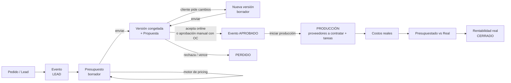

# PRODUCT SPEC — Sistema operativo para productoras de eventos

> Estado: **borrador para aprobación** · Fecha: 2026-10-05
> Documentos relacionados: [ARCHITECTURE](../architecture/ARCHITECTURE.md) · [DOMAIN_MODEL](./DOMAIN_MODEL.md) · [MVP](./MVP.md) · [DECISIONS](./DECISIONS.md)
> Nombre del producto: **a definir** (DECISIONS → D-02). Autoría y propiedad intelectual: Julieta Arrazate.

---

## 1. Visión de producto

**En una frase:** el lugar donde una productora administra su negocio, desde que entra un pedido hasta que sabe cuánto ganó.

**El problema.** Hoy una productora presupuesta en Excel. Cada presupuesto copia el anterior y arrastra precios viejos. Las fórmulas se rompen. Se confunde markup con margen. Las versiones viven en archivos `presupuesto_final_v3_AHORA_SI.xlsx`. Cuando el cliente aprueba, el presupuesto muere: producción vuelve a cargar todo en otra planilla y nadie compara lo presupuestado con lo gastado. El dueño se entera de cuánto ganó meses después, si es que se entera.

**La tesis.** El presupuesto no es un documento. Es **el objeto central del negocio**, y a lo largo de su vida se transforma:

```
pedido → presupuesto → propuesta → aprobación → producción → costo real → rentabilidad
```

Cada dato se carga **una sola vez** y alimenta todo lo que sigue.

**Para quién (en orden de prioridad):**

1. Productoras de eventos chicas y medianas (2–30 personas) en Argentina.
2. Agencias BTL / de activaciones y empresas de stands.
3. Más adelante: proveedores de servicios para eventos y otros mercados de LatAm.

**Posicionamiento.** Herramientas como Runzi, ProducerOS o Festara validan la categoría ("quote → job → actuals"). Nuestra diferencia es ser **nativos de Argentina**:

- **Inflación:** costos con fecha, aviso cuando un costo está desactualizado y aumentos masivos por proveedor.
- **Impuestos y monedas:** IVA según el régimen fiscal, costos en USD con tipo de cambio congelado, y cargos sobre la venta (IIBB, impuesto al cheque) incluidos en el margen real.
- **WhatsApp como canal:** la propuesta se comparte por WhatsApp con vista previa.
- **Un motor de pricing más profundo** que "un % de markup".

### Principios de producto (no negociables)

| # | Principio | Qué significa en la práctica |
|---|---|---|
| P1 | **Cada dato se carga una vez** | Proveedor → producto → costo alimenta presupuesto, propuesta, producción, costos reales y rentabilidad. |
| P2 | **Los números son confiables** | Un único motor de pricing en el servidor. Decimales exactos. Tests de cada fórmula. Lo que ve el cliente siempre suma exacto. |
| P3 | **La historia no se reescribe** | Precios con historial. Versiones enviadas inmutables. Snapshots. Audit log. |
| P4 | **Cero fórmulas para el usuario** | El usuario elige *intenciones* ("quiero 25% de margen", "el cliente tiene $5M") y el sistema hace la matemática. |
| P5 | **Más rápido que Excel** | Si armar un presupuesto es más lento que en Excel, el producto pierde. El teclado en desktop y el pulgar en mobile son ciudadanos de primera. |
| P6 | **Flexible donde la realidad es flexible** | Hay líneas libres (no todo está en el catálogo), se puede pisar cualquier markup, se puede exportar a Excel. |
| P7 | **La IA sugiere, el sistema valida, el humano confirma** | La IA nunca fija precios ni confirma compras. |

---

## 2. Usuarios y roles

| Persona | Rol en el sistema | Qué necesita | Dispositivo principal |
|---|---|---|---|
| Dueño/a de la productora | OWNER | Saber qué pasa con el negocio en 5 segundos, controlar márgenes y aprobar descuentos grandes. | Celular (consulta), desktop (análisis) |
| Administración | ADMIN | Mantener catálogo, proveedores, precios, usuarios y configuración fiscal. | Desktop |
| Gerente comercial / de cuentas | MANAGER | Supervisar presupuestos, negociar y aprobar bajo margen mínimo. | Ambos |
| Productor/a comercial | QUOTER | Armar presupuestos rápido, enviarlos y seguirlos. | Desktop (armar), celular (ajustar, compartir) |
| Jefe/a de producción | PRODUCTION | Ejecutar el evento aprobado, contratar proveedores y cargar costos reales. | Celular en campo |
| Socio/a, contador/a | VIEWER | Consultar sin modificar. | Ambos |
| Taller / montaje | CREW | Ver lo que tiene asignado (piezas y tareas) y avisar en qué está. | Celular en taller y en predio |
| **Cliente final** (externo) | — (link público) | Ver la propuesta, aceptarla o rechazarla y descargar el PDF. | Celular |
| Proveedor (externo, V2+) | — | Recibir pedidos de cotización y órdenes de compra. | — |

La matriz de permisos está en la §9.

---

## 3. Ciclo de vida del negocio



**Decisión clave:** el evento existe **desde el primer momento** (LEAD). No se "convierte" un presupuesto en evento: el evento **avanza de estado** y el presupuesto aceptado queda como su línea de base. Esto cumple P1 sin migraciones de datos entre módulos. Ver [DOMAIN_MODEL §3](./DOMAIN_MODEL.md#3-máquinas-de-estado).

---

## 4. Módulos — descripción funcional

Leyenda: **MVP** = entra en el MVP · **V2** = después · **Base** = soporte transversal.

### 4.1 Dashboard (MVP, reducido)

Responde *"¿qué está pasando con mi negocio?"* en 5 segundos. Muestra pocos KPIs y mucha acción.

```
BUENOS DÍAS, JULI                                      Octubre 2026 ▾

Enviado este mes    Aceptado          En negociación    Margen prom. aceptado
$28.400.000         $14.800.000       $7.200.000        31,4 %
                                                        Conversión 90 días: 64 %

PARA HACER HOY
● 3 propuestas sin respuesta hace +5 días         →
● 2 propuestas vistas y no respondidas            →
● 1 propuesta vence mañana                        →
● 4 costos desactualizados en presupuestos abiertos →

PRÓXIMOS EVENTOS
Hoy      Nike · Salta              PRODUCCIÓN   margen 27,4 %
Jue 9    Coca-Cola · La Rural      APROBADO     margen 31,0 %
```

Cada número está definido con precisión en la §8 para que nadie discuta qué significa "aceptado este mes".

### 4.2 Clientes / CRM liviano (MVP)

- Datos: empresa, razón social, CUIT, condición frente al IVA, dirección, notas, contactos (nombre, cargo, email, teléfono, principal).
- **Historial comercial** calculado, no cargado a mano:

```
Coca-Cola                                           CUIT 30-XXXXXXXX-X
12 presupuestos · 8 aceptados · 4 perdidos · conversión 67 %
Facturado histórico (aceptado, sin IVA)   $84.200.000
Margen promedio estimado / real           28,7 % / 26,9 %
Markup preferencial                       20 % (regla de cliente)
```

- Fuera del MVP: pipeline de oportunidades, emails integrados y scoring (V2).

### 4.3 Eventos (MVP)

El evento es el **contenedor principal**. Tiene:

- Datos: cliente, nombre, fechas (inicio/fin, "a confirmar" permitido), días de evento, días de armado/desarme, lugar, ciudad, responsable, estado y notas.
- Pestañas: **Resumen · Presupuestos · Producción · Costos reales · Rentabilidad · Documentos**.
- Estados: `LEAD → QUOTING → SENT → NEGOTIATION → APPROVED → IN_PRODUCTION → COMPLETED → CLOSED`, más los terminales `LOST` y `CANCELLED`. Respecto de la lista original, sacamos `DRAFT` (es idéntico a `QUOTING`) y agregamos `LOST` (sin él, la tasa de conversión no se puede calcular). Ver DECISIONS → D-11.

### 4.4 Proveedores (MVP)

- Datos: nombre, razón social, CUIT, condición IVA, rubros (categorías), contactos, condiciones de pago, notas y evaluación interna (1–5 ★ con comentario).
- Productos que ofrece, con su costo vigente y su historial.
- Historial calculado: eventos en los que participó, total presupuestado y total real, desvío promedio ("este proveedor suele cobrar +6% de lo cotizado").
- **"¿Quién me ofrece esto?"**: desde un producto se ven todas las ofertas vigentes ordenadas por costo, con antigüedad del precio.

```
Lona tensada (m²)
Proveedor C    $ 98.000   hace 12 días   ★★★★☆
Proveedor A    $105.000   hace 3 días    ★★★★★   ← preferido
Proveedor B    $112.000   hace 64 días ⚠ desactualizado
```

- V2: pedidos de cotización a proveedores (RFQ), tiempo promedio de respuesta, portal de proveedor y órdenes de compra.

### 4.5 Catálogo inteligente (MVP)

- **Producto/servicio** = ítem genérico del catálogo: nombre, categoría, unidad, modo de cobro (`fijo` o `por día`), descripción interna y descripción para el cliente por defecto, cantidad mínima, markup o margen objetivo propio (opcional), alícuota de IVA y activo/inactivo.
- **Oferta de proveedor** (proveedor × producto) con **historial de costos append-only**: costo, moneda, si incluye IVA, vigente desde, origen (manual, importación, aumento masivo) y quién lo cargó. Los recursos propios (equipo de armado propio) se modelan como un proveedor interno "Equipo propio".
- **Importar desde Excel/CSV** con vista previa, validación y simulación antes de confirmar. **Es crítico para la adopción**: nadie va a cargar 300 productos a mano.
- **Aumento masivo**: "Proveedor X subió 8% desde el 1/11" o "Categoría Transporte +12%". Genera nuevas entradas de historial, nunca pisa las anteriores.
- **Aviso de costo desactualizado**: badge cuando el costo vigente tiene más de N días (configurable, por defecto 30).
- **Paquetes / plantillas**: "Stand corporativo 6×3" = lista de productos con cantidades por defecto, regla de días y sección. Insertar un paquete crea N líneas editables. V2: paquetes paramétricos (las cantidades salen de las medidas del stand) y paquetes a precio cerrado.

### 4.6 Motor de presupuestación y pricing (MVP — el corazón)

Especificación matemática completa en [DOMAIN_MODEL §5](./DOMAIN_MODEL.md#5-motor-de-pricing--especificación). En términos de producto:

- **Tres modos de pricing**, por línea y por presupuesto:
  - **Markup:** "+30% sobre el costo".
  - **Margen objetivo:** "quiero 25% de margen". El sistema calcula el precio y, si están configurados, **descuenta los cargos sobre la venta (IIBB, etc.)** para que el 25% sea real.
  - **Precio objetivo:** "el cliente tiene $5.000.000". El sistema reparte el precio entre las líneas no bloqueadas y muestra markup, margen y ganancia resultantes. Avisa si queda por debajo del margen mínimo.
- **Cadena de markup** con su origen siempre visible ("30% · viene de: categoría Gráfica"):
  `línea manual > presupuesto > cliente > producto > categoría > organización`.
- **Siempre se muestran por separado** costo, venta, ganancia, markup % y margen %. Nunca se presentan como sinónimos.
- **Descuentos:** por línea (%) y global (%, visible para el cliente como renglón propio).
- **Impuestos:** IVA según el régimen de la organización ("+ IVA" o "IVA incluido"). Los cargos sobre la venta configurables (IIBB, impuesto al cheque, comisiones) cuentan como costo para el margen real.
- **Moneda:** costos en ARS o USD. El tipo de cambio queda **congelado en la versión** y cambiarlo es una acción explícita.
- **Redondeo comercial** configurable (al peso, a $100 o a $1.000). Invariante: **lo que ve el cliente siempre suma exacto**.

### 4.7 Presupuestos y versiones (MVP)

- Un presupuesto pertenece a un evento. Normalmente hay uno por evento. Puede haber más de uno para alternativas, aunque en el MVP las alternativas se arman como presupuestos separados.
- **Borrador → Congelado.** Mientras el presupuesto es borrador se puede editar (con autoguardado). Al **enviar**, la versión se congela y se vuelve inmutable. Cualquier cambio posterior crea `v(n+1)` como copia de la última.
- **Comparar versiones** (v2 vs v3): líneas agregadas, quitadas y modificadas (cantidad, costo, markup, precio), con el delta de total y de margen.
- **Snapshot de costos:** cada línea guarda el costo usado. Si el catálogo cambia, un banner avisa *"3 líneas tienen costos más nuevos — Revisar"* y el usuario decide si actualizar viendo el impacto. **Ni siquiera un borrador se actualiza solo.**
- **Duplicar presupuesto** de otro evento ("el stand del año pasado"). Las líneas toman los costos **actuales**, con un aviso de las diferencias.
- **Líneas libres** (sin producto del catálogo), con la opción "Guardar en catálogo".
- **Secciones** con título para el cliente ("Producción gráfica", "Estructura", "Logística").
- **Exportar a Excel** la versión interna. Es la salida de emergencia que da confianza para dejar Excel.

### 4.8 Propuesta comercial (MVP)

- Se genera desde una versión congelada. El cliente **nunca** ve costo, proveedor, markup, margen ni notas internas. Esto se garantiza en el servidor con una lista blanca de campos (ver ARCHITECTURE §8.4).
- **Modos de presentación:** (a) detalle con importes por línea, (b) totales por sección con descripciones sin precios por línea, (c) solo total. Las productoras suelen ocultar precios unitarios para que el cliente no "elija a la carta".
- Cada línea tiene **nombre interno** ("Lona tensada 3×2 Prov. X") y **descripción para el cliente** ("Gráfica frente de stand, lona tensada con bastidor").
- Incluye vigencia (7 días por defecto), condiciones comerciales, forma de pago, IVA, logo y colores de la productora.
- **Link público seguro** con token y **PDF**. Se comparte por **WhatsApp** (share nativo del celular con vista previa del link sin montos) o por email (Resend).
- El cliente puede **aceptar** (nombre, email, comentario opcional), **rechazar** (motivo) o descargar el PDF. Se registran timestamp, IP, user-agent y **hash del contenido aceptado**, que es la evidencia.
- **Aprobación manual con número de OC**: las empresas grandes aprueban por mail o con orden de compra, no con un botón. Sin esto, el flujo no refleja la realidad corporativa.
- Tracking de "vista": primera vez, última vez y cantidad.
- Si se envía una versión nueva, la propuesta anterior queda **reemplazada**: el link viejo muestra "Hay una versión más reciente".

### 4.9 Producción (MVP liviano)

Al iniciar producción de un evento aprobado:

- Se genera la **lista de contratación por proveedor**, derivada de la versión aceptada: proveedor, ítems, costo presupuestado y estado (`A contratar`, `Confirmado`, `Cancelado`). No se vuelve a cargar nada.
- Hay un **checklist de tareas** simple (título, responsable, fecha y estado), con tareas sugeridas por categoría como plantilla opcional.
- V2: órdenes de compra a proveedores, crew y personal con horarios, logística, calendario y documentos operativos.

### 4.10 Costos reales y Presupuestado vs Real (MVP)

- Se carga un gasto desde el celular, en campo: monto, moneda, proveedor, categoría, **línea presupuestada** (opcional), fecha, foto del comprobante y nota.
- Comparación por **categoría** y **proveedor** siempre; por **línea** cuando el gasto está vinculado. Los gastos sin presupuesto aparecen como "No presupuestado".

```
                 PRESUPUESTADO        REAL        DESVÍO
Proveedor X        $500.000       $520.000    +$20.000  +4,0 %
Personal           $300.000       $280.000    −$20.000  −6,7 %
Transporte         $200.000       $240.000    +$40.000 +20,0 %
Materiales         $150.000       $170.000    +$20.000 +13,3 %
TOTAL            $1.150.000     $1.210.000    +$60.000  +5,2 %

Margen estimado 28,0 %   →   Margen real 24,2 %
```

> Nota de verificación: con un margen estimado de 28% sobre un costo de $1.150.000, la venta es $1.597.222,22 y el margen real con $1.210.000 de costo es **24,24%** (el spec original decía 24,1%). Ver los vectores de prueba en DOMAIN_MODEL §5.8.

### 4.11 Rentabilidad y reportes (MVP: por evento, cliente y período · V2: categoría, proveedor y usuario)

Ingresos, costo total, ganancia bruta, markup, margen, desvío y estimado vs real.

### 4.12 Asistente IA (V2 — Fase 6)

*"Cliente quiere un stand 6×3 en La Rural durante 3 días con gráfica, iluminación, mobiliario, armado y desarme."* → la IA propone un **borrador estructurado**: evento, días, paquetes probables y productos **del catálogo**, con cantidades. **Los precios los calcula siempre el motor de pricing, nunca el modelo.** El usuario revisa y confirma. Ver ARCHITECTURE §11.

### 4.13 Transversales (Base, MVP)

Auth, organizaciones, usuarios y roles, audit log, documentos/adjuntos, notificaciones por email (propuesta vista, aceptada o rechazada; invitaciones) y configuración.

---

## 5. User journeys

### J1 — Onboarding de la productora (OWNER/ADMIN, desktop, una vez)

1. Recibe una invitación, crea su contraseña y entra a una organización vacía con un checklist de 5 pasos.
2. **Datos fiscales:** razón social, CUIT, condición IVA (Responsable Inscripto / Monotributo), alícuota IIBB y otros cargos sobre la venta.
3. **Marca:** logo, color, condiciones comerciales por defecto y vigencia por defecto.
4. **Importar catálogo** desde su Excel: sube el archivo, mapea las columnas (producto, categoría, proveedor, unidad, costo, moneda, ¿incluye IVA?), revisa la vista previa con errores marcados y confirma. Se crean categorías, proveedores, productos, ofertas e historial (origen = importación).
5. **Markups por categoría** (la tabla de "Gráfica 35%, Estructura 40%…") y el markup general.
6. Invita a su equipo y asigna roles.

**Criterio de éxito:** catálogo real cargado en menos de 30 minutos.

### J2 — Presupuesto rápido desde un pedido por WhatsApp (QUOTER, desktop o celular)

1. Llega un pedido por WhatsApp. Toca **+ Nuevo presupuesto**.
2. Cliente: busca "Coca" y aparece Coca-Cola (o lo crea inline con solo el nombre).
3. Evento: "Lanzamiento verano", fecha 15/11 (o "a confirmar") y 3 días. Se crea el evento en estado `QUOTING`.
4. **Agregar paquete** "Stand corporativo 6×3": aparecen 12 líneas agrupadas en secciones, con costos vigentes y markups resueltos.
5. Ajusta cantidades. Agrega una línea libre ("Cartel acrílico especial"). Ve en el pie fijo: **Costo · Venta · Ganancia · Margen**, recalculados al instante.
6. Cambia a **precio objetivo $5.000.000**: ve markup 28,2% y margen 22%, con aviso si queda bajo el margen mínimo.
7. **Generar propuesta**: elige el modo (totales por sección) y la vigencia. Se congela v1, se crea la propuesta y aparece **Compartir → WhatsApp / Email / Copiar link / PDF**.

**Criterio de éxito:** presupuesto típico con paquete en **menos de 10 minutos**, sin fórmulas.

### J3 — Negociación con versiones (QUOTER / MANAGER)

1. El cliente responde *"¿se puede bajar a 4,6?"*.
2. El usuario abre el presupuesto (v1 enviada, solo lectura) y toca **Nueva versión**: se crea el borrador v2.
3. Baja la cantidad de mobiliario y quita la iluminación extra. O fija el precio objetivo $4.600.000 bloqueando las líneas que no quiere tocar.
4. **Compara v1 ↔ v2**: −2 líneas, costo −$200.000, venta $5.000.000 → $4.600.000, margen 22,0% → 19,6%.
5. Envía v2. La propuesta de v1 pasa a "reemplazada". El evento queda en `NEGOTIATION`.

### J4 — El cliente acepta (externo, celular)

1. Abre el link desde WhatsApp. Ve la propuesta con la marca de la productora, carga rápida y diseño mobile.
2. Revisa y toca **Aceptar propuesta**. Confirma nombre, email y comentario opcional.
3. Ve "¡Gracias! La productora fue notificada" y puede descargar el PDF.
4. La productora recibe un email y el evento pasa a `APPROVED`. Queda registrado el hash del contenido aceptado.

**Variante:** el cliente aprueba por mail con una OC. El MANAGER marca **Aprobar manualmente**, carga el n° de OC y adjunta el PDF de la OC.

### J5 — Pasar a producción (MANAGER / PRODUCTION)

1. En el evento aprobado, toca **Iniciar producción**.
2. Aparece la lista de contratación por proveedor (derivada de la versión aceptada) y el checklist de tareas sugeridas.
3. Asigna responsables. A medida que confirma proveedores, marca `Confirmado`.

### J6 — Costos reales en campo (PRODUCTION, celular, con una mano)

1. En el evento de hoy, toca **+ Gasto**.
2. Saca la foto del comprobante, carga el monto, elige el proveedor (sugerido por la lista del evento) y la línea presupuestada (sugerida).
3. Ve al instante: "Transporte: presupuestado $200.000 · real $240.000 · **+20%**".

### J7 — Cierre y rentabilidad (OWNER)

1. Con el evento `COMPLETED`, se cargan los últimos gastos y se pasa a `CLOSED`.
2. La rentabilidad real queda fija y alimenta los reportes por cliente y por período.

### J8 — Actualización de precios de un proveedor (ADMIN)

1. Llega la nueva lista del Proveedor X. Se aplica **Aumento masivo +8% desde 1/11** o se importa el Excel del proveedor.
2. Se crea un historial nuevo y los costos anteriores quedan intactos.
3. Los **presupuestos enviados no cambian**. Los **borradores abiertos** muestran el banner "costos más nuevos disponibles".

### J9 — El dueño, 8 AM, desde el celular (OWNER)

Abre la PWA instalada y ve el dashboard con lo enviado, lo aceptado, el margen y las 3 cosas para hacer hoy. Toca "propuesta vista y no respondida" y entra al evento para llamar al cliente.

---

## 6. Navegación y arquitectura de información

### 6.1 Mapa de pantallas

```
(app)                                   (público)
├── Inicio (dashboard)                  └── /p/{token}         Propuesta pública
├── Eventos                                 └── /p/{token}/pdf
│   ├── Lista (filtros por estado, fecha, cliente, responsable)
│   └── Evento
│       ├── Resumen
│       ├── Presupuestos → Editor de presupuesto
│       │                  ├── Versiones / Comparar
│       │                  └── Propuestas (enviar, estado, aprobación manual)
│       ├── Producción (contratación por proveedor + tareas)
│       ├── Costos reales
│       ├── Rentabilidad (presupuestado vs real)
│       └── Documentos
├── Presupuestos (pipeline comercial: borrador / enviado / visto / negociación / aceptado / perdido)
├── Catálogo
│   ├── Productos → Producto (ofertas, historial de costos, "¿quién lo ofrece?")
│   ├── Paquetes
│   ├── Importar
│   └── Aumento masivo
├── Clientes → Cliente (contactos, historial, eventos, presupuestos, regla de markup)
├── Proveedores → Proveedor (contactos, rubros, ofertas, historial, evaluación)
├── Reportes (rentabilidad por evento / cliente / período)
└── Configuración
    ├── Organización (datos fiscales, marca)
    ├── Usuarios y roles
    ├── Pricing (markup general, por categoría, margen mínimo, redondeo)
    ├── Impuestos y cargos sobre la venta
    ├── Monedas y tipo de cambio
    ├── Propuestas (condiciones, vigencia, modo por defecto)
    └── Categorías y unidades
```

### 6.2 Navegación por dispositivo

**Mobile (barra inferior, alcanzable con el pulgar):**

```
┌─────────────────────────────────────────────┐
│  Inicio   Eventos    [ + ]    Presup.   Más │
└─────────────────────────────────────────────┘
```

- **[ + ]** central abre un bottom sheet: *Nuevo presupuesto · Nuevo gasto · Nuevo cliente · Nuevo evento*.
- **Más:** Catálogo, Clientes, Proveedores, Reportes, Configuración.

**Desktop:** sidebar fija con todas las secciones y **búsqueda global (⌘K / Ctrl+K)** sobre clientes, eventos, presupuestos (por número `#1048`), productos y proveedores.

**Tablet:** sidebar colapsable con el mismo layout que desktop.

### 6.3 Rutas (Next.js)

| Ruta | Pantalla |
|---|---|
| `/` | Dashboard |
| `/events`, `/events/[id]`, `/events/[id]/{budgets,production,costs,profitability,documents}` | Eventos |
| `/budgets` | Pipeline de presupuestos |
| `/budgets/[id]` | Editor (versión borrador o la última) |
| `/budgets/[id]/v/[n]` | Versión específica (solo lectura si está congelada) |
| `/budgets/[id]/compare?a=2&b=3` | Comparador |
| `/catalog/products`, `/catalog/products/[id]`, `/catalog/packages`, `/catalog/import`, `/catalog/bulk-update` | Catálogo |
| `/clients`, `/clients/[id]` · `/suppliers`, `/suppliers/[id]` | Maestros |
| `/reports` | Reportes |
| `/settings/*` | Configuración |
| `/p/[token]` | Propuesta pública (SSR, sin login) |

---

## 7. Pantalla central: el editor de presupuesto

Es **la pantalla más importante del producto**. Objetivo: igual de rápida que Excel para un usuario experto y más clara para todos.

### 7.1 Desktop (≥1024px)

```
┌─ #1048 · Coca-Cola · Lanzamiento verano · 15/11 · 3 días ───────── v2 BORRADOR ─┐
│ [Comparar] [Versiones ▾] [Exportar ▾]                         [Generar propuesta] │
├──────────────────────────────────────────────────────────────┬────────────────────┤
│ 🔎 Agregar producto, paquete o línea libre…   (/)            │ RESUMEN            │
│                                                              │                    │
│ ▾ PRODUCCIÓN GRÁFICA                             $ 270.000   │ Costo    $ 700.000 │
│   Lona tensada 3×2   Prov. A   2 u  × $100.000  35%  $270.000│ Venta    $ 940.000 │
│ ▾ ESTRUCTURA                                     $ 420.000   │ Ganancia $ 240.000 │
│   Estructura 6×3     Prov. B   1 u  × $300.000  40%  $420.000│ Markup     34,3 %  │
│ ▾ ARMADO Y LOGÍSTICA                             $ 250.000   │ Margen     25,5 %  │
│   Armado             Propio    1 u  × $ 80.000  25%  $100.000│ ─────────────────  │
│   Transporte         Prov. D   2 vj × $ 60.000 ●25%  $150.000│ Cargos s/venta     │
│     ⚠ costo de hace 47 días                                  │ IIBB 3,5% $ 32.900 │
│                                                              │ Margen real 22,0 % │
│ + Sección                                                    │ ─────────────────  │
│                                                              │ Pricing: [Markup ▾]│
│                                                              │ Precio obj. [    ] │
│                                                              │ Desc. global [  %] │
│                                                              │ IVA 21%  $197.400  │
│                                                              │ TOTAL  $1.137.400  │
└──────────────────────────────────────────────────────────────┴────────────────────┘
 ● = markup pisado manualmente (tooltip: "25% · manual · antes 20% de categoría Transporte")
 Los números de este mockup están verificados (mismas 4 líneas que el ejemplo del spec original).
```

- **Teclado primero:** `/` busca, `Enter` agrega, `Tab` recorre cantidad → días → markup, `Ctrl+D` duplica la línea y `Del` la borra (con deshacer).
- Cada línea muestra solo lo necesario. Al hacer clic se abre un **panel lateral** con todo el detalle: proveedor alternativo, costo e historial, moneda y tipo de cambio, modo de pricing, descuento, descripción para el cliente y notas internas.
- Arrastrar para reordenar líneas y secciones.
- Edición de cantidades con un parser **es-AR**: `1.500` = mil quinientos y `1,5` = uno coma cinco. El valor interpretado se muestra al instante para evitar errores de coma y punto.

### 7.2 Mobile (<640px)

```
┌──────────────────────────────┐
│ ← #1048 Coca-Cola       ⋯    │
│   Lanzamiento verano · v2    │
├──────────────────────────────┤
│ PRODUCCIÓN GRÁFICA $270.000 ▾│
│ ┌──────────────────────────┐ │
│ │ Lona tensada 3×2         │ │
│ │ 2 u × $100.000 · 35%     │ │
│ │                 $270.000 │ │
│ └──────────────────────────┘ │
│ ESTRUCTURA        $420.000 ▾ │
│ ┌──────────────────────────┐ │
│ │ Estructura 6×3           │ │
│ │ 1 u × $300.000 · 40%     │ │
│ │                 $420.000 │ │
│ └──────────────────────────┘ │
│ …                            │
│                        ( + ) │
├──────────────────────────────┤
│ Costo $700.000  Venta $940.000│
│ Ganancia $240.000  Margen 25,5%│  ← pie fijo, tap = resumen completo
│ [   Generar propuesta    ]   │
└──────────────────────────────┘
```

- Tocar una línea abre un **bottom sheet** con stepper de cantidad (− / +), días, markup (chips: 20 · 25 · 30 · 35 · personalizado) y "más opciones".
- El botón **( + )** agrega un producto o paquete (buscador a pantalla completa) o una línea libre.
- El **pie fijo** muestra siempre costo, venta, ganancia y margen. El margen cambia de color si queda bajo el mínimo.
- En mobile **no** se muestran columnas tipo planilla. Se muestran tarjetas con jerarquía.

### 7.3 Reglas de UX del editor

- **Autoguardado** con indicador ("Guardado · hace 2 s"). Nunca hay un botón "Guardar" para el borrador.
- **Recalculo** por el servidor con debounce. Los totales muestran un estado sutil de "recalculando" (sin spinners que bloqueen). Ver ARCHITECTURE §6.3.
- **Conflictos:** si otro usuario editó la misma versión, se muestra un aviso claro y se recarga sin perder lo tipeado.
- **Deshacer** para borrar líneas, secciones y paquetes.
- Los avisos (costo viejo, margen bajo mínimo, tipo de cambio viejo) **nunca bloquean** en el MVP. En V2, el margen mínimo puede requerir la aprobación de un MANAGER.

---

## 8. Definición de métricas (dashboard y reportes)

Todas las métricas son **sin IVA**, en la moneda base de la organización (ARS), y respetan los permisos (quien no puede ver márgenes no ve métricas de margen).

| Métrica | Definición exacta |
|---|---|
| **Presupuestado** (período) | Suma de venta neta de las versiones congeladas por primera vez en el período (una por presupuesto: la última del período). |
| **Enviado** (período) | Suma de venta neta de la última propuesta enviada por presupuesto con `sent_at` en el período. |
| **Aceptado** (período) | Suma de venta neta de las propuestas aceptadas (online o manual) con `decided_at` en el período. |
| **Rechazado / Perdido** | Lo mismo, con decisión de rechazo o evento marcado `LOST`. |
| **En negociación** | Venta neta de la última propuesta activa (enviada o vista, sin decisión y sin vencer) por presupuesto. Es una foto actual, no del período. |
| **Tasa de conversión** | `aceptados / (aceptados + perdidos + vencidos)` por **cantidad** y por **monto**, sobre las decisiones del período. Se excluyen los abiertos. |
| **Margen promedio** | **Ponderado por venta**: `Σ ganancia / Σ venta neta` de lo aceptado. No es el promedio simple de los porcentajes. |
| **Ganancia estimada** | Ganancia de la versión aceptada (incluye cargos sobre la venta). |
| **Ganancia real** | Venta neta aceptada − costos reales − cargos sobre la venta. Solo para eventos con costos cargados. Se marca "parcial" si el evento no está `CLOSED`. |
| **Desvío de costo** | `(costo real − costo presupuestado) / costo presupuestado`. |
| **"Para seguir"** | Propuestas sin decisión enviadas hace más de N días (configurable, por defecto 5), vistas y sin respuesta hace más de 48 h, o que vencen en menos de 48 h. |

---

## 9. Permisos (RBAC)

Roles fijos en el MVP (los roles personalizados quedan para V2). Una persona puede tener un rol distinto en cada organización.

| Capacidad | OWNER | ADMIN | MANAGER | QUOTER | PRODUCTION | VIEWER | CREW |
|---|:-:|:-:|:-:|:-:|:-:|:-:|:-:|
| Ver dashboard comercial | ✓ | ✓ | ✓ | propio | — | ✓ | — |
| **Ver costos de proveedor** | ✓ | ✓ | ✓ | ✓ | ✓ | config. | — |
| **Ver markup / margen / ganancia** | ✓ | ✓ | ✓ | ✓ | — | config. | — |
| Clientes: crear/editar | ✓ | ✓ | ✓ | ✓ | — | — | — |
| Proveedores y catálogo: editar | ✓ | ✓ | ✓ | — | — | — | — |
| **Cambiar costos / aumento masivo / importar** | ✓ | ✓ | ✓ | — | — | — | — |
| Configuración de pricing (markups por categoría, margen mínimo) | ✓ | ✓ | — | — | — | — | — |
| Presupuestos: crear/editar borrador | ✓ | ✓ | ✓ | ✓ | — | — | — |
| Pisar markup por línea | ✓ | ✓ | ✓ | ✓ | — | — | — |
| Enviar propuesta | ✓ | ✓ | ✓ | ✓ | — | — | — |
| Aprobar manualmente (con OC) / marcar perdido | ✓ | ✓ | ✓ | — | — | — | — |
| Iniciar producción / gestionar tareas | ✓ | ✓ | ✓ | — | ✓ | — | — |
| Cargar costos reales | ✓ | ✓ | ✓ | — | ✓ | — | — |
| Cerrar evento | ✓ | ✓ | ✓ | — | — | — | — |
| Usuarios y roles | ✓ | ✓ | — | — | — | — | — |
| Datos fiscales, facturación del SaaS, borrar organización | ✓ | — | — | — | — | — | — |
| Ver audit log | ✓ | ✓ | — | — | — | — | — |
| Mis tareas: ver y mover lo asignado a uno | ✓ | ✓ | ✓ | ✓ | ✓ | ✓ | ✓ |

- "propio" = solo sus presupuestos y eventos.
- "config." = la organización decide si VIEWER ve costos y márgenes.
- **CREW (Taller/Montaje) solo tiene "Mis tareas"**: no ve presupuestos, clientes, eventos ni plata; lo de otra persona responde 404.
- **PRODUCTION ve costos pero no márgenes**: necesita saber cuánto pagarle al proveedor, no cuánto gana la productora.
- La ocultación de campos se hace **en el servidor** (los campos no viajan), no escondiéndolos en la UI.

---

## 10. Riesgos de producto

| # | Riesgo | Prob. | Impacto | Mitigación |
|---|---|:-:|:-:|---|
| RP1 | **Más lento o rígido que Excel**: el usuario vuelve a la planilla. | Alta | Crítico | Líneas libres, teclado primero, paquetes, duplicar presupuesto, exportar a Excel. Medir el tiempo para armar un presupuesto con el usuario real desde la Fase 2. |
| RP2 | **El catálogo se desactualiza** (inflación) y el usuario deja de confiar en los costos. | Alta | Alto | Antigüedad visible, aumento masivo por proveedor o categoría, importación de listas, banner en borradores. |
| RP3 | **Sesgo de un solo usuario** (el amigo): se construye *su* flujo y no el del mercado. | Media | Alto | Entrevistar a 4–5 productoras más antes de V2. Configurar en vez de hardcodear lo que varía (DECISIONS §Configurables). |
| RP4 | **Alcance gigante** (25 módulos): nunca se llega a usar. | Alta | Crítico | MVP estricto. **El piloto real arranca al terminar la Fase 3** (cotizar y enviar), no al final de todo. |
| RP5 | Los clientes corporativos **no aprueban online**. | Alta | Medio | Aprobación manual con OC y adjunto, desde el MVP. |
| RP6 | El pricing avanzado **asusta**. | Media | Medio | Por defecto solo markup. Margen objetivo y precio objetivo detrás de un selector, con resultado explicado en lenguaje natural. |
| RP7 | **Margen expuesto** a quien no debe verlo (freelancers, producción). | Media | Alto | Permisos a nivel de campo en el servidor y tests de visibilidad. |
| RP8 | La **carga de costos reales** no se hace (es trabajo extra en campo). | Alta | Alto | Carga en 3 toques con foto, sugerencias automáticas de proveedor y línea, y recordatorio al pasar a `COMPLETED`. Sin costos reales no hay rentabilidad: es la métrica de éxito más importante post-MVP. |
| RP9 | **Diferenciación débil** frente a Runzi, ProducerOS y Festara. | Media | Medio | Foco Argentina (inflación, IVA, USD, WhatsApp) y profundidad del motor de pricing. |
| RP10 | **Disposición a pagar** desconocida. | Media | Medio | Validar el precio con el piloto y 5 productoras más antes de construir el billing (V2). |

---

## 11. Métricas de éxito del producto

| Métrica | Objetivo del piloto |
|---|---|
| Tiempo para armar un presupuesto típico (con paquete) | < 10 min (hoy, en Excel: medir la línea de base con el amigo) |
| % de líneas de presupuesto que salen del catálogo (vs. libres) | > 70 % |
| Presupuestos del piloto hechos en el sistema (vs. Excel) | 100 % al mes 2 |
| Eventos aprobados con costos reales cargados | > 80 % |
| Diferencias numéricas reportadas por el usuario contra su cálculo propio | 0 sin explicación |
| Propuestas abiertas por el cliente (tasa de vista) | Medir |

---

## 12. Glosario (español ↔ código)

| Producto (UI) | Código / API | Nota |
|---|---|---|
| Organización / productora | `organization` | Tenant |
| Cliente | `client` | Empresa que contrata |
| Contacto | `client_contact` / `supplier_contact` | |
| Evento | `event` | Contenedor principal (job) |
| Presupuesto | `budget` | Pertenece a un evento |
| Versión | `budget_version` | `DRAFT` o `FROZEN` |
| Sección | `budget_section` | Agrupador visible para el cliente |
| Línea / concepto | `budget_line` | Con snapshot completo |
| Propuesta | `proposal` | Versión congelada publicada al cliente |
| Producto / servicio | `product` | Ítem genérico del catálogo |
| Oferta de proveedor | `supplier_product` | Proveedor × producto |
| Historial de costos | `price_history` | Append-only |
| Paquete / plantilla | `package` | |
| Regla de markup | `markup_rule` | Organización, categoría, producto o cliente |
| Cargo sobre la venta | `sale_charge` | IIBB, impuesto al cheque, comisiones |
| Gasto / costo real | `expense` | |
| Proveedor a contratar | `event_supplier` | Lista de contratación |
| Tarea | `production_task` | |
| Markup | `markup` | `(venta − costo) / costo` |
| Margen | `margin` | `(venta − costo) / venta` |
